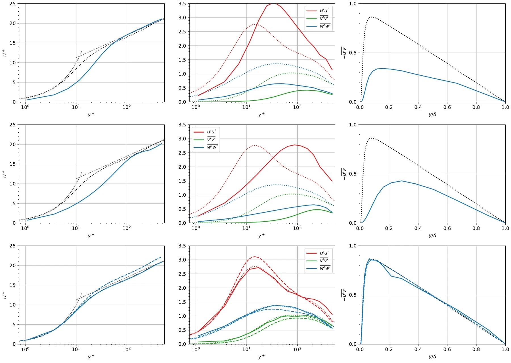
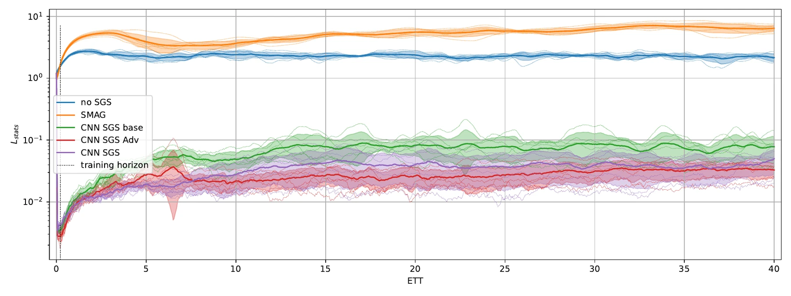
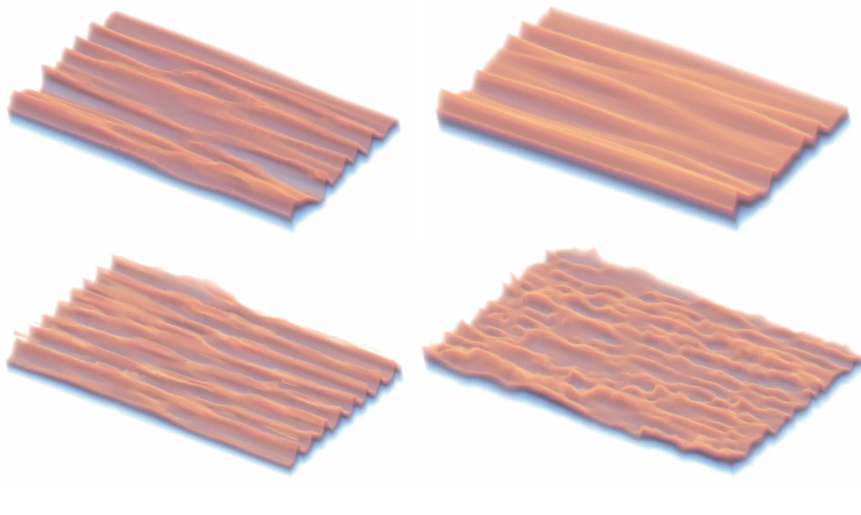
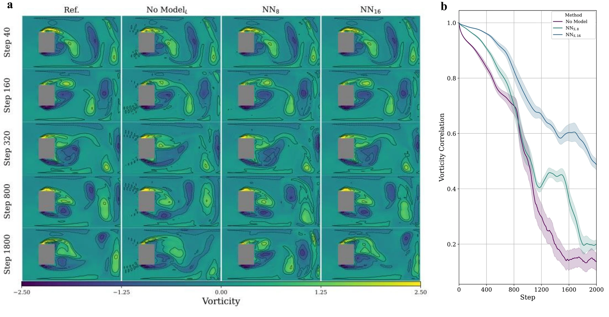
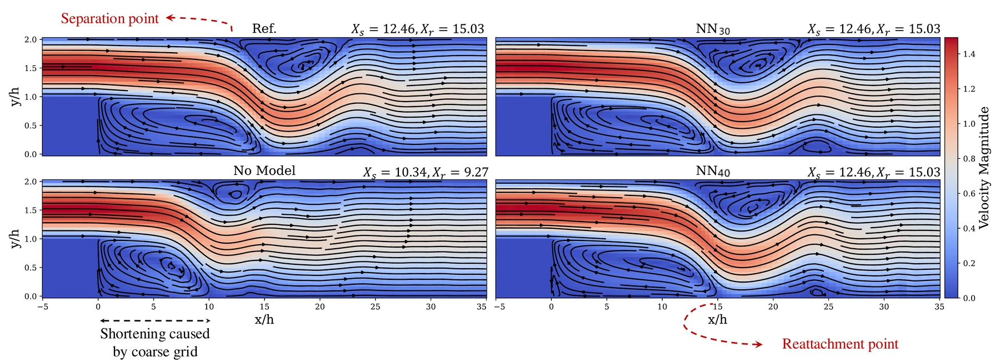
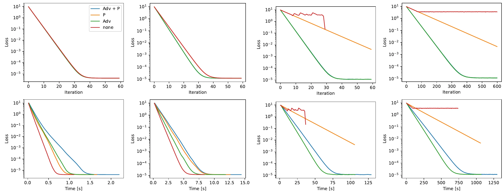

# Results from the Paper

This page summarizes the learning experiments of the PICT paper. All figures on this page are reproduced from

> A. Franz, H. Wei, L. Guastoni, N. Thuerey. *PICT – A Differentiable, GPU-Accelerated Multi-Block PISO Solver for Simulation-Coupled Learning Tasks in Fluid Dynamics.* Journal of Computational Physics 544 (2026) 114433. [doi:10.1016/j.jcp.2025.114433](https://doi.org/10.1016/j.jcp.2025.114433) (open access, CC BY 4.0)

where you can also find the complete setups, training details and further evaluations. Figure numbers refer to the arXiv version of the paper, [arXiv:2505.16992v2](https://arxiv.org/abs/2505.16992).

All three tasks train a neural network that predicts a **correcting force \(\mathbf{S}_\theta\)** for a coarse PICT simulation. The networks are trained by unrolling the differentiable solver. They cover supervised training on instantaneous flow fields as well as training on flow statistics alone, and they all use grids refined towards obstacles and walls.

~40×

faster than OpenFOAM for a 3D turbulent channel flow, at lower statistics error (learned SGS model, 1 GPU vs. 32 CPU cores)

548

Reτ of the learned SGS model (target 550; no model: 390, Smagorinsky: 452)

&gt;180×

longer stable rollout than the training horizon (20,000 steps vs. 108 steps)

~110×

lower time-averaged velocity error than the no-model baseline for the backward-facing step

## 3D turbulent channel flow: a learned SGS model from statistics alone

A turbulent channel flow at \(\text{Re}_\tau = 550\) is simulated on a coarse \(64\times32\times32\) grid that is refined towards the walls. A 3D CNN built from [multi-block convolutions](../guide/learning.md#multi-block-convolutions) acts as a sub-grid-scale (SGS) model. Its inputs are the velocity and the wall distance, and it has about 199k parameters. It is trained **only on reference turbulence statistics**: mean velocity, Reynolds stresses and shear stress from the DNS of Hoyas & Jiménez. No paired high-resolution snapshots are used. Training uses 12 differentiable steps after a randomized, growing number of non-differentiable warm-up steps.

<figure markdown>
  { .on-white }
  <figcaption>Turbulence statistics for the channel flow at Reτ = 550 with different SGS models. Top to bottom: no SGS model, Smagorinsky, and the learned CNN SGS model. The resulting average Reτ are 390, 452 and 548. (Franz et al. 2026, Fig. 11)</figcaption>
</figure>

The learned model:

- **matches the target statistics**, with Reτ = 548 against the target of 550,
- reproduces the **turbulent energy budgets** although it was not trained on them, with slight deviations close to the wall and in the dissipation term,
- **stays stable for 20,000 steps**, more than 180× the 108-step training horizon, with a statistics error about two orders of magnitude below the baselines.

<figure markdown>
  { .on-white }
  <figcaption>Per-frame statistics loss over a 20,000-step rollout. The CNN models see at most 108 steps during training (dashed vertical line). Solid lines: mean over 6 initial conditions; shaded: standard deviation. (Franz et al. 2026, Fig. 13)</figcaption>
</figure>

<figure markdown>
  { .on-white width="640" }
  <figcaption>Streamwise velocity near the lower wall. Top: no SGS model and Smagorinsky. Bottom: learned SGS model and the down-sampled high-resolution reference. With the learned model, the spacing of the streamwise streaks is closer to the reference than without a model or with Smagorinsky. (Franz et al. 2026, Fig. 14)</figcaption>
</figure>

**Runtime.** The corrected simulation with PICT needs **223 s** for 20 eddy turnover times on a single GPU, of which 38.7% is the network. OpenFOAM's PISO solver needs **2.5 h** on 32 cores of a Xeon Gold 5220R at the finer resolution of \(192\times96\times96\) (34.4 TFLOPS of compute, compared with 11.34 TFLOPS available to PICT), and its aggregated statistics error is 36% higher (\(1.19\times10^{-2}\) vs. \(8.78\times10^{-3}\)). The corrected simulation is therefore about 40× faster and more accurate. As the paper notes, the learned solver is less general than OpenFOAM. The four initial training phases took about 42 hours on a single GTX 1080 Ti.

## 2D vortex street: learned corrector with unrolled training

A coarse simulation of the flow around a square obstacle (4× coarser in space and 10× in time than the reference) is corrected by a 2D CNN. The CNN is trained with a supervised velocity loss on unrolled trajectories of 8 (NN8) or 16 (NN16) steps and tested on obstacle geometries not seen in training.

<figure markdown>
  { .on-white }
  <figcaption>(a) Vorticity at steps 40 to 1800 for the reference, the uncorrected coarse simulation and the learned correctors NN8 and NN16. (b) Vorticity correlation with the reference over time. (Franz et al. 2026, Fig. 7)</figcaption>
</figure>

| Metric (mean over test cases) | No model | NN8 | NN16 |
|---|---:|---:|---:|
| vorticity correlation, step 120 | 0.933 | 0.976 | **0.987** |
| vorticity correlation, step 2000 | 0.136 | 0.199 | **0.488** |
| MSE (×10⁻¹), step 2000 | 17.285 | 1.424 | **0.762** |

The longer unroll during training clearly improves long-term accuracy. NN16 also stabilizes the force coefficients: the drag MSE drops from 2.14 to \(4.86\times10^{-3}\) and the lift MSE from 0.936 to \(1.29\times10^{-3}\).

## 2D backward-facing step: matching time-averaged flow

For a backward-facing step, the correctors are trained on instantaneous fields but evaluated on time-averaged quantities over 6000 steps, for an unseen expansion ratio and Reynolds number.

<figure markdown>
  { .on-white }
  <figcaption>Time-averaged streamlines over 6000 steps. The coarse baseline shortens the recirculation zones. The learned correctors NN30 and NN40 recover the separation (Xs) and reattachment (Xr) points of the reference. (Franz et al. 2026, Fig. 8)</figcaption>
</figure>

The time-averaged velocity MSE of the corrected simulation is \(1.744\times10^{-4}\), about **110× lower** than that of the baseline (\(1.928\times10^{-2}\)). The corrected coarse run takes 986.4 s. A 256 × 64 simulation of similar accuracy takes 1729.5 s.

## Gradient paths

The paper also studies which parts of the gradient are needed. The test case is an optimization of an initial-velocity scale through \(n\) unrolled steps, run with the full gradient (Adv+P), with only the advection or only the pressure solve gradient, or without any backward linear solve ("none").

<figure markdown>
  { .on-white }
  <figcaption>Loss (top) and runtime (bottom) for rollouts of n = 1, 10 and 100 steps (the last with learning rate 0.01 and 0.001). (Franz et al. 2026, Fig. 6)</figcaption>
</figure>

| Wall-clock time to reach loss < 10⁻⁴ [s] | Adv+P | P | Adv | none |
|---|---:|---:|---:|---:|
| n = 1 | 1.084 | 0.689 | 0.775 | **0.515** |
| n = 10 | 6.853 | 6.707 | 5.479 | **4.393** |
| n = 100 | 63.20 | 157.5 | **52.11** | diverges |
| n = 100, lr = 0.001 | 674.3 | 1611 | **552.1** | – |

Skipping the backward solves gives up to **2× faster** optimization for short rollouts. For long rollouts the advection gradient is essential, while the pressure gradient can still be dropped. The options to choose the gradient paths are described in [Differentiable Simulation](../guide/differentiable.md#gradient-paths-trading-accuracy-for-speed).
