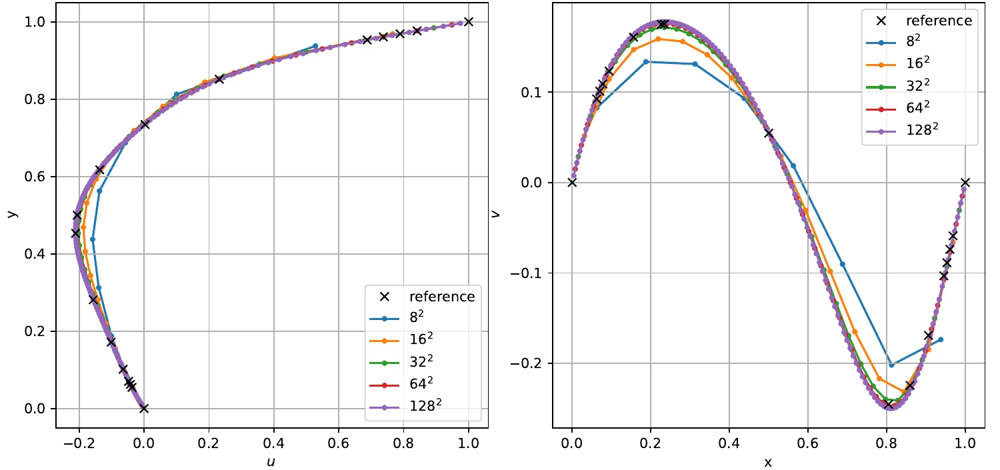
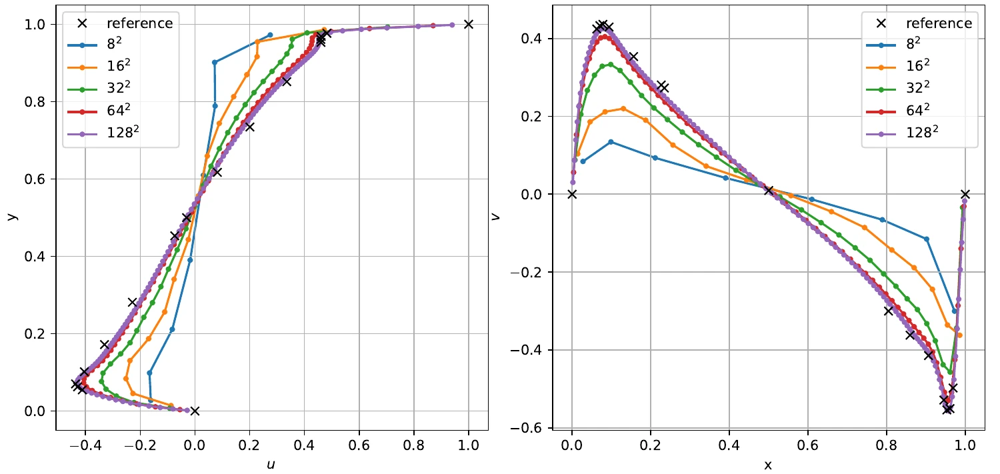
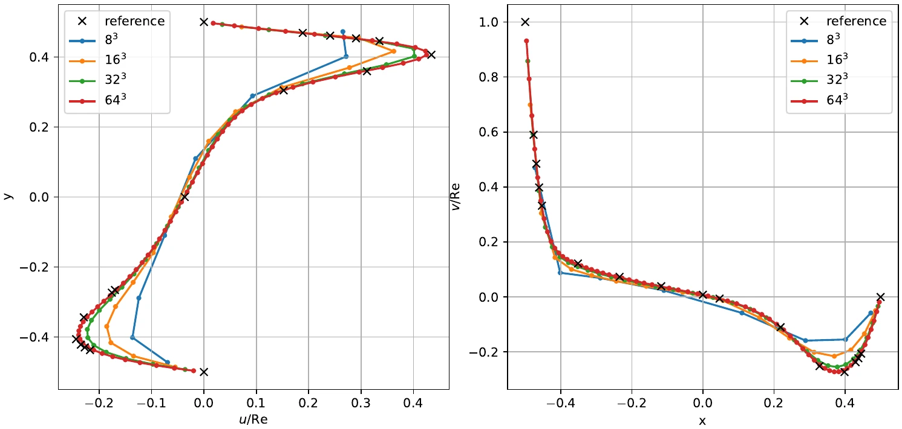
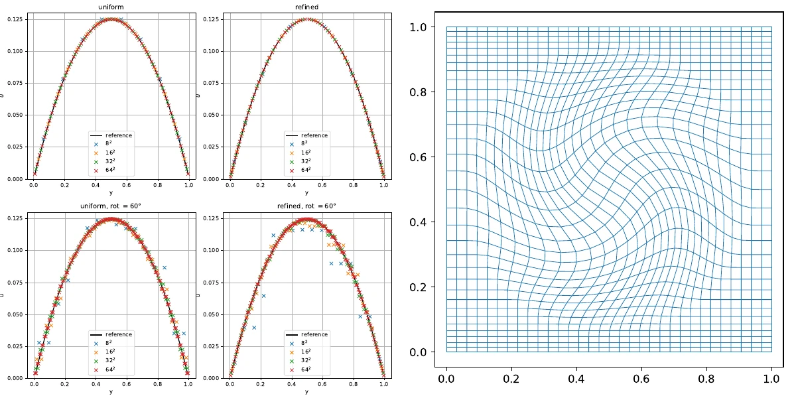
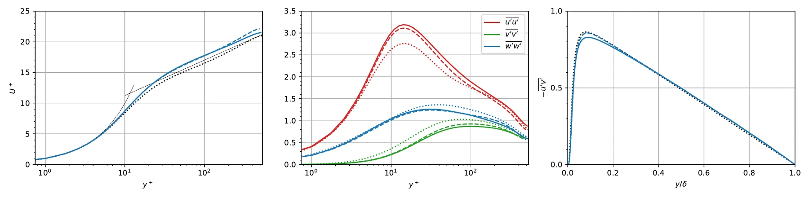
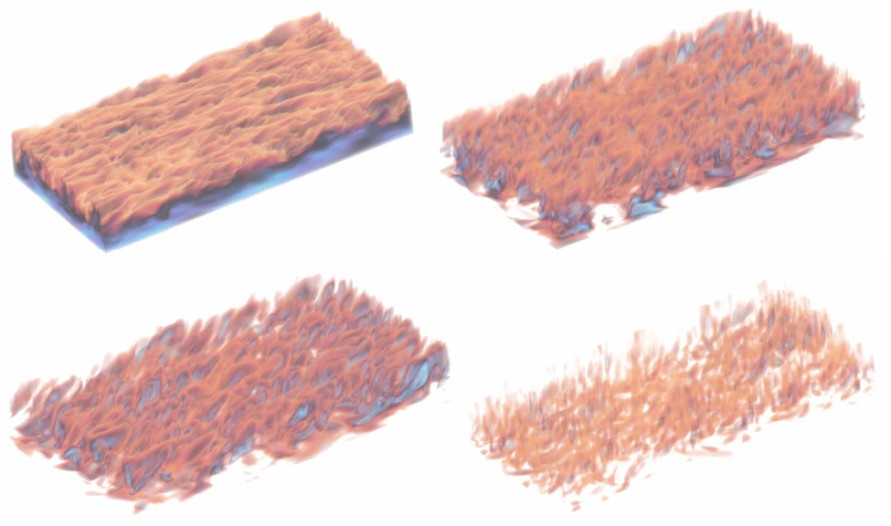
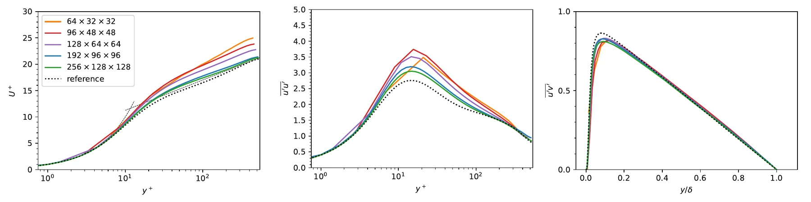
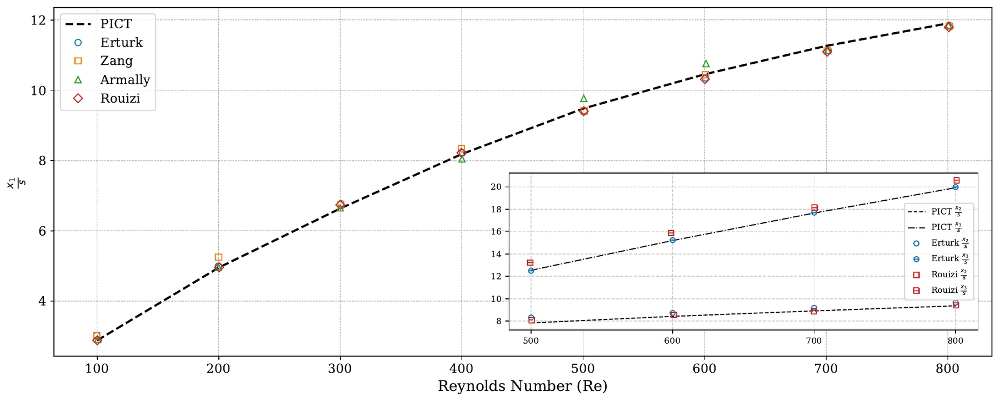
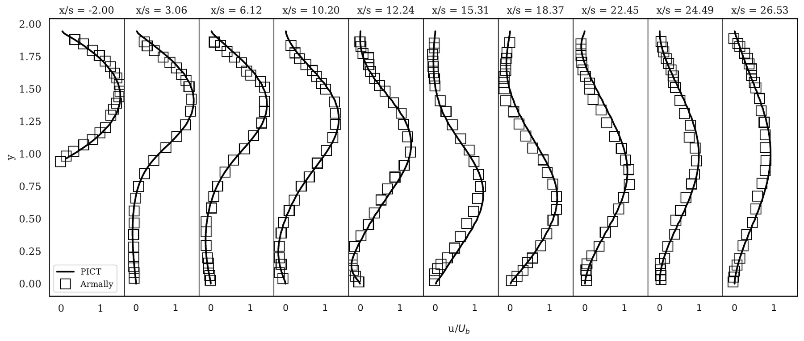

# Validation

PICT has been validated against analytic solutions, established numerical references and another solver (OpenFOAM). Except for the first figure, which was produced with the current code for this website, the figures on this page are taken from the paper (Franz et al., JCP 2026, CC BY 4.0). Figure numbers refer to the arXiv version of the paper, [arXiv:2505.16992v2](https://arxiv.org/abs/2505.16992).

## 2D lid-driven cavity

The lid-driven cavity is the classic test for incompressible solvers. A square cavity is closed by no-slip walls, and the top lid moves with unit velocity. The velocity profiles along the vertical and horizontal center lines are compared with the reference data of Ghia et al. (1982)[^ghia]. These reference values ship with PICT in `tests/validations.py`.

<figure markdown>
  
  
  <figcaption>Center-line velocities of the 2D lid-driven cavity at Re = 100 (top) and Re = 1000 (bottom), simulated with the current PICT code on uniform grids of 16², 32² and 64² cells and compared with Ghia et al. (1982). The runs use float32 and the default solver settings and simulate 40 (Re = 100) and 100 (Re = 1000) time units. Produced for this website with <code>scripts/sim_cavity.py</code>.</figcaption>
</figure>

With increasing resolution, the profiles converge towards the reference. At Re = 1000, the RMS deviation at the reference points decreases from 0.074 to 0.026 for u and from 0.122 to 0.025 for v between 16² and 64².

??? note "Data table: deviation from Ghia et al. at the 15 interior reference points"
    | Re | grid | RMS dev. u | RMS dev. v | max dev. u | max dev. v |
    |---:|---:|---:|---:|---:|---:|
    | 100 | 16² | 0.0148 | 0.0119 | 0.0260 | 0.0228 |
    | 100 | 32² | 0.0046 | 0.0036 | 0.0090 | 0.0053 |
    | 100 | 64² | 0.0029 | 0.0036 | 0.0070 | 0.0071 |
    | 1000 | 16² | 0.0738 | 0.1218 | 0.1394 | 0.1809 |
    | 1000 | 32² | 0.0420 | 0.0540 | 0.0761 | 0.0918 |
    | 1000 | 64² | 0.0261 | 0.0246 | 0.0444 | 0.0387 |

!!! warning "Solver tolerances on fine grids"
    The default tolerances of the linear solvers (1e-5 for float32, 1e-8 for float64) apply to the RMS of the residual vector, which is an absolute measure. When we refined this cavity to 128² cells at Re = 1000 with the float32 defaults, the pressure CG solves used 16.5 iterations on average, fewer than the 25.2 on the 64² grid, and the result after 100 time units deviated *more* from the reference than the 64² result (RMS deviation of u: 0.088 instead of 0.026). With `advection_tol = pressure_tol = 1e-7`, the same 128² run used 184 CG iterations on average and reached an RMS deviation of 0.0069, the lowest of all our Re = 1000 runs (`scripts/check_cavity_tolerance.py`). For fine grids, check the convergence of your solves and tighten `pressure_tol` / `advection_tol`, or use double precision, which the validation functions in `tests/validations.py` use by default.

The paper reports the same comparison for Re = 100 and Re = 5000, each on uniform and on wall-refined grids. With increasing resolution, the solution converges to the reference. At the higher Reynolds number, the refined grid further improves the results, while at Re = 100 the uniform grid performs better.

<figure markdown>
  { .on-white }
  <figcaption>Re = 100 on uniform grids from 8² to 128². Left: u on the vertical center line. Right: v on the horizontal center line. (Franz et al. 2026, Fig. B.16a)</figcaption>
</figure>

<figure markdown>
  { .on-white }
  <figcaption>Re = 5000 on grids from 8² to 128² that are refined towards all walls. (Franz et al. 2026, Fig. B.16d)</figcaption>
</figure>

## 3D lid-driven cavity

At Re = 1000, the 3D cavity converges to the reference of Albensoeder & Kuhlmann (2005)[^albensoeder] with increasing resolution (8³ to 64³), and grid refinement towards the boundaries further improves the result.

<figure markdown>
  { .on-white }
  <figcaption>Velocity profiles for the 3D lid-driven cavity at Re = 1000 on grids of increasing resolution that are refined towards all boundaries. As in the paper, the velocities are normalized with the Reynolds number. (Franz et al. 2026, Fig. 3b)</figcaption>
</figure>

## Plane Poiseuille flow

A periodic channel with no-slip walls, driven by a constant forcing, is compared to the analytic parabolic profile. The test covers uniform grids, grids refined towards the walls, and rotationally distorted grids.

<figure markdown>
  { .on-white width="560" }
  <figcaption>u-velocity profiles of the plane Poiseuille flow for resolutions from 8² to 64². "refined" uses a grid refined towards the walls, "rot = 60°" a rotationally distorted grid, the refined version of which is shown on the right. (Franz et al. 2026, Fig. B.15)</figcaption>
</figure>

## 3D turbulent channel flow

A turbulent channel flow at \(\text{Re}_\tau = 550\) is simulated on a \(192\times96\times96\) grid over \(2\pi\times2\times\pi\). The statistics are accumulated over 20 eddy turnover times after a warm-up of 20 eddy turnover times. They are compared with the spectral DNS of Hoyas & Jiménez (2008)[^hoyas] and with OpenFOAM's PISO solver on **the same mesh**. The statistics of PICT closely match those of OpenFOAM, both are reasonably close to the spectral reference, and the average \(\text{Re}_\tau\) of PICT is 534.

<figure markdown>
  { .on-white }
  <figcaption>Mean velocity, Reynolds normal stresses and shear stress. Solid: PICT. Dashed: OpenFOAM on the same mesh. Dotted: spectral reference. (Franz et al. 2026, Fig. 4)</figcaption>
</figure>

<figure markdown>
  { .on-white width="640" }
  <figcaption>Velocity components and pressure near the bottom wall of the channel. Top: u and v. Bottom: w and p. (Franz et al. 2026, Fig. 5)</figcaption>
</figure>

A resolution study shows convergence towards the reference. The average friction Reynolds number increases from 467 (\(64\times32\times32\)) over 479, 502 and 534 to 541 (\(256\times128\times128\)), against the target of 550. The turbulent fluctuations do not fully converge to the spectral reference, which the paper suggests might be due to the dissipation of the low-order discretization.

<figure markdown>
  { .on-white }
  <figcaption>Channel-flow statistics for increasing resolution, each normalized with its own average friction velocity. (Franz et al. 2026, Fig. B.22)</figcaption>
</figure>

## Backward-facing step

The 2D backward-facing step (geometry after Rouizi et al.) is evaluated over the Reynolds number. The reattachment length is compared with the numerical results of Erturk, Zang and Rouizi and the experiments of Armaly et al. (1983; spelled "Armally" in the figure legend) for Re = 100 to 800, and velocity profiles are compared with the measurements of Armaly et al. at Re = 1290.

<figure markdown>
  { .on-white }
  { .on-white }
  <figcaption>Top: reattachment length over the Reynolds number; the inset shows the detachment and reattachment points at the top wall. Bottom: velocity profiles at Re = 1290. (Franz et al. 2026, Fig. B.21)</figcaption>
</figure>

## Gradients

The custom gradient operations are compared with finite-difference approximations using `torch.autograd.gradcheck` (`tests/gradcheck.py`, in double precision). The paper reports agreement up to numerical precision. On the application level, the paper verifies the gradients with optimizations that must recover known parameters: an initial-velocity scale in a periodic box (loss below \(10^{-5}\)), and the lid velocity and the viscosity of a 2D cavity (residuals of \(6.44\times10^{-6}\) and \(5.46\times10^{-6}\)). A small example of this kind is shown in [Differentiable Simulation](../guide/differentiable.md#a-minimal-optimization).

## Run the validations yourself

```bash
python run_validations.py   # plane Poiseuille flow + 2D lid-driven cavity (Re = 100), several resolutions
python run_tests.py         # unit and gradient tests of the kernels (~30 min)
```

`run_validations.py` writes the profile plots to `./test_runs/<timestamp>_<name>/`. In the script, you can switch to the 3D cavity or other Reynolds numbers.

[^ghia]: U. Ghia, K. N. Ghia, C. T. Shin, *High-Re solutions for incompressible flow using the Navier–Stokes equations and a multigrid method*, Journal of Computational Physics 48 (1982) 387–411.
[^albensoeder]: S. Albensoeder, H. C. Kuhlmann, *Accurate three-dimensional lid-driven cavity flow*, Journal of Computational Physics 206 (2005) 536–558.
[^hoyas]: S. Hoyas, J. Jiménez, *Reynolds number effects on the Reynolds-stress budgets in turbulent channels*, Physics of Fluids 20 (2008) 101511.
