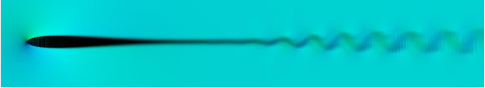

# NACA 0012 Airfoil

!!! source "Source"

    - **Script:** [`airfoil_sample.py`](https://github.com/tum-pbs/PICT/blob/main/airfoil_sample.py), with the profile in [`sample_airfoils/naca0012_sharp.dat`](https://github.com/tum-pbs/PICT/blob/main/sample_airfoils/naca0012_sharp.dat)
    - **Run:** `python airfoil_sample.py` from the repository root

This sample simulates the flow around a NACA 0012 airfoil with a sharp trailing edge at a chord Reynolds number of 10,000. It shows how to build a body-fitted **C-grid** from an airfoil contour with PICT's interpolation helpers, how to connect blocks with **flipped orientations**, and how to handle inflow and outflow on a curved outer boundary.

<figure markdown>
  
  
  <figcaption>The 3-block C-grid of the sample at full resolution, zoomed in. Blue: the C-shaped block around the airfoil (159 × 143 cells). Orange and green: the upper and lower wake blocks (316 × 143 cells each).</figcaption>
</figure>

<figure markdown>
  
  <figcaption>Developed 2D flow around and behind the airfoil, with the 2D velocity mapped to a color circle. Further downstream, the wake starts to oscillate. (Franz et al. 2026, Fig. B.18)</figcaption>
</figure>

## Building the C-grid

The airfoil coordinates are read from a Selig-style `.dat` file: a name line followed by `x y` pairs. They start at the trailing edge and run counter-clockwise. The three blocks are then generated with `shapes.generate_grid_vertices_2D`, which interpolates the interior from four corners and optional border curves:

- **The C-block.** Its inner border is the airfoil contour and its outer border is a C-shaped curve: straight lines at y = ±2 above and below the airfoil, joined by a half circle of radius 2 around the leading edge. On the half circle, the outer points are where the normals of the airfoil points meet the circle; along the straight parts, they are evenly spaced. Cells grow by a factor of 1.03 away from the surface, starting at half the smallest spacing of the airfoil points.
- **Two wake blocks** extend 4 chord lengths downstream of the trailing edge, above and below the wake center line. Their cells grow by a factor of 1.01 in the streamwise direction.

```python
airfoil_grid = shapes.generate_grid_vertices_2D([normal_res, airfoil_res], airfoil_grid_corners,
    [None, None, airfoil_coords_flat, coords_outer_flat], x_weights=normal_weights, dtype=dtype)
coords_tail_upper = shapes.generate_grid_vertices_2D([normal_res, tail_res_x], corners_tail_upper, None,
    x_weights=normal_weights_inverse, y_weights=tail_weights, dtype=dtype)
coords_tail_lower = shapes.generate_grid_vertices_2D([normal_res, tail_res_x], corners_tail_lower, None,
    x_weights=normal_weights, y_weights=tail_weights, dtype=dtype)
```

## Connecting the blocks

In the C-block, x runs along the airfoil surface and y points away from it. Both ends of the C meet the wake blocks. The upper wake block's y axis points *towards* the wake center line, so that connection is **flipped** (`"+y"`):

```python
viscosity = torch.tensor([1e-4], dtype=dtype, device=cpu_device)          # chord 1, velocity 1 -> Re = 10,000
domain = PISOtorch.Domain(2, viscosity, name="DomainNACA0012", dtype=dtype, device=cuda_device, passiveScalarChannels=0)

block_airfoil    = domain.CreateBlock(vertexCoordinates=airfoil_grid, name="Airfoil")
block_tail_upper = domain.CreateBlock(vertexCoordinates=coords_tail_upper, name="TailUpper")
block_tail_lower = domain.CreateBlock(vertexCoordinates=coords_tail_lower, name="TailLower")

block_airfoil.ConnectBlock("-x", block_tail_upper, "-x", "+y")      # flipped
block_airfoil.ConnectBlock("+x", block_tail_lower, "-x", "-y")
block_tail_upper.ConnectBlock("+y", block_tail_lower, "-y", "-x")   # along the wake center line
```

## Boundaries

```python
in_vel = torch.tensor([[1.0, 0.0]], device=cuda_device, dtype=dtype)

# outer boundary of the C-block: inflow. Closing +y also closes the periodic partner -y,
# the airfoil surface, which becomes a no-slip wall.
block_airfoil.CloseBoundary("+y", in_vel)
block_tail_upper.CloseBoundary("-y", in_vel)       # top and bottom of the wake region
block_tail_lower.CloseBoundary("+y", in_vel)

# outflow at the end of the wake blocks: varying values, advected in every step
for block in (block_tail_upper, block_tail_lower):
    block.CloseBoundary("+x", in_vel)
    block.getBoundary("+x").makeVelocityVarying()
out_bounds = [block_tail_upper.getBoundary("+x"), block_tail_lower.getBoundary("+x")]
PISOtorch_simulation.balance_boundary_fluxes(domain, out_bounds)

char_vel = in_vel.clone()
def update_outflow(domain, time_step, **kwargs):
    out_bounds = [domain.getBlock(1).getBoundary("+x"), domain.getBlock(2).getBoundary("+x")]
    PISOtorch_simulation.update_advective_boundaries(domain, out_bounds, char_vel, time_step.cuda())

for block in domain.getBlocks():
    block.velocity[:, 0, :, :] = 1.0               # start from the free-stream velocity
domain.PrepareSolve()
```

Every face that is not connected to another block gets a prescribed boundary. Connecting a periodic face turns its opposite face into a no-slip wall: after the connections above, the far-field faces of the wake blocks (`-y` of the upper and `+y` of the lower block) and their outflow faces (`+x`) are walls, and the `CloseBoundary` calls then assign the free-stream velocity to them. The C-grid is not orthogonal, so the simulation uses the non-orthogonal correction:

```python
sim = PISOtorch_simulation.Simulation(domain=domain, prep_fn={"PRE": update_outflow},
        substeps="ADAPTIVE", time_step=0.1, corrector_steps=2, advection_tol=1e-6, pressure_tol=1e-7,
        advect_non_ortho_steps=2, pressure_non_ortho_steps=4, pressure_return_best_result=True,
        velocity_corrector="FD", non_orthogonal=True,
        log_interval=1, norm_vel=True, log_dir=log_dir, output_resampling_shape=out_shape,
        save_domain_name="domain", output_resampling_fill_max_steps=16)
sim.preconditionBiCG = False
sim.BiCG_precondition_fallback = True
sim.make_divergence_free()
sim.run(200)
```

`output_resampling_fill_max_steps=16` fills holes when the fine curvilinear cells near the airfoil and the coarse cells far away are resampled into one uniform output image.

## Running

```bash
python airfoil_sample.py
```

`airfoil_res_div` coarsens the airfoil contour by averaging neighboring points, which gives a coarser grid. The grid construction assumes a contour in the same `.dat` format that starts at a sharp trailing edge, runs counter-clockwise, and has its leading edge at the origin on the x-axis.
