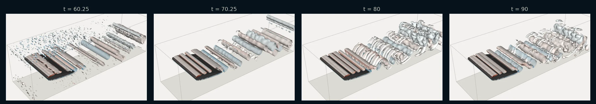

# Airfoil in a Channel (2D & 3D)

!!! source "Source"

    - **Script:** [`airfoil_channel_sample.py`](https://github.com/tum-pbs/PICT/blob/main/airfoil_channel_sample.py)
    - **Setup:** adapted from the code of [FluidGym](https://openreview.net/forum?id=ilEooI8fK1) (Becktepe et al., ICML 2026), where it is the uncontrolled flow of the airfoil environments
    - **Run:** `python airfoil_channel_sample.py` from the repository root (2D; the 3D run is commented out at the end of the script)

A NACA 0012 airfoil at 10° angle of attack in a channel. The flow separates from the upper side and sheds vortices into the wake. Six blocks are refined towards the airfoil surface. The same setup runs in 2D or, extruded with a periodic span, in 3D, where the 3D run starts from the developed 2D flow.

<figure class="pict-media" markdown>
  <video autoplay loop muted playsinline poster="../../imgs/flows/airfoil_vorticity_poster.webp">
    <source src="../../assets/videos/airfoil_vorticity.mp4" type="video/mp4">
  </video>
  <figcaption>2D vorticity at Re = 3000 in the full channel (x = −1.5 to 4.5, blue: clockwise, red: counter-clockwise), from t = 10 to t = 60. Every iteration of 0.25 time units is shown at 15 frames per second. Simulated with PICT using the setup and solver settings of the sample, and rendered for this website.</figcaption>
</figure>

**Setup** (default run of the sample)

- Channel of height 1.4 from x = −1.5 (inflow) to x = 4.5 (outflow), airfoil of chord 1 with the leading edge at the origin, turned by 10° (trailing edge down)
- 6 blocks with 46,806 cells, 95 cells normal to the airfoil with a cell size factor of 0.97 between neighbors
- Parabolic inflow with mean velocity 0.3, advective outflow through the two wake blocks
- Re = 3000, based on the chord and the mean inflow velocity (viscosity 10<sup>−4</sup>)
- 240 iterations of 0.25 time units: according to the script, the inflow passes the airfoil ca. 18 times

## Grid

<figure markdown>
  
  
  <figcaption>The grid from the inflow to x = 2, one color per block, every grid line drawn: the block between inflow and airfoil, the front, top and bottom blocks around the airfoil, and the two wake blocks. Drawn with the grid function of the sample by <code>scripts/viz_example_grids.py</code>.</figcaption>
</figure>

`make_airfoil_channel_grids` reads the airfoil from `sample_airfoils/naca0012_sharp.dat` and rotates it around the leading edge. It then assigns every point of the airfoil surface a point on the outer boundary: on the upper or lower channel wall, or on a rectangle in front of the airfoil. This splits the surface into the parts of the top, front and bottom blocks. The wake blocks start with the smallest spacing of the airfoil points and grow by `tail_grow_mul` per cell. The sample uses:

```python title="airfoil_channel_sample.py" linenums="389"
    grids = make_airfoil_channel_grids(airfoil_path, attack_angle=attack_angle, channel_height=1.4, inflow_x=-1.5, outflow_x=4.5, front_x=-0.5,
        res_normal=96, normal_base=0.97, tail_grow_mul=1.01, dtype=dtype)
```

Compared with [NACA 0012 Airfoil](airfoil.md), which uses a C-grid in an open domain, this setup has walls at the top and bottom, and its in- and outflow are straight faces.

## Blocks and boundaries

The airfoil surface is one face each of the front, top and bottom blocks, and the top and bottom faces of the outer blocks are the channel walls. For 3D, every block becomes periodic in z, and the connections give the mapping for both tangential axes:

```python title="airfoil_channel_sample.py" linenums="277" hl_lines="3 4 5 12 13 14 27 28 29 30 31 32"
    # set boundaries
    # airfoil
    Bf.CloseBoundary("+x")
    Bt.CloseBoundary("-y")
    Bb.CloseBoundary("+y")
    # channel walls
    Bl.CloseBoundary("-y")
    Bl.CloseBoundary("+y")
    Bt.CloseBoundary("+y")
    Btu.CloseBoundary("+y")
    Btl.CloseBoundary("-y")
    if dims==3:
        for block in [Bl, Bf, Bt, Bb, Btu, Btl]:
            block.MakePeriodic("z")

    # connect the blocks
    # parameters are: block_from, side of block_from to connect, block_to, side of block_to to connect, axes
    # for 3D the axes are given for both remaining dimensions, in the order (y,z) for x-faces and (z,x) for y-faces
    if dims==2:
        Bl.ConnectBlock("+x", Bf, "-x", "-y")
        Bf.ConnectBlock("+y", Bt, "-x", "+y")
        Bf.ConnectBlock("-y", Bb, "-x", "-y")
        Bt.ConnectBlock("+x", Btu, "-x", "-y")
        Bb.ConnectBlock("+x", Btl, "-x", "-y")
        Btu.ConnectBlock("-y", Btl, "+y", "-x")
    else:
        Bl.ConnectBlock("+x", Bf, "-x", "-y", "-z")
        Bf.ConnectBlock("+y", Bt, "-x", "-z", "+y")
        Bf.ConnectBlock("-y", Bb, "-x", "-z", "-y")
        Bt.ConnectBlock("+x", Btu, "-x", "-y", "-z")
        Bb.ConnectBlock("+x", Btl, "-x", "-y", "-z")
        Btu.ConnectBlock("-y", Btl, "+y", "-z", "-x")
```

The inflow is a parabolic profile, and the outflow faces of the two wake blocks are advected with the mean inflow velocity, as in the [cylinder channel](cylinder_channel.md#blocks-and-boundaries).

## Running the simulation

The grid is strongly curved near the airfoil. Like `airfoil_sample.py` and `vortex_street_torus_sample.py`, the sample uses 2 non-orthogonal corrector iterations for the advection and 4 for the pressure; the cylinder channel uses 1 each. The comments explain the choice of the pressure tolerance:

```python title="airfoil_channel_sample.py" linenums="407" hl_lines="5 6 13 14 15"
    # FluidGym uses a pressure tolerance of 1e-7 (1e-8 in 3D), which is at the precision limit of the single precision CG solver for
    # this grid in 2D: many pressure solves then run to the iteration limit, making the simulation ca. 5x slower.
    # In 3D 1e-6 is not enough: the solver errors grow to an instability at the outflow, where the two wake blocks meet.
    sim = PISOtorch_simulation.Simulation(domain=domain, block_layout=layout, prep_fn=None,
            substeps="ADAPTIVE", time_step=time_step, corrector_steps=2, advection_tol=1e-6, pressure_tol=1e-6 if res_z==0 else 1e-7,
            advect_non_ortho_steps=2, pressure_non_ortho_steps=4, pressure_return_best_result=True,
            velocity_corrector="FD", non_orthogonal=True,
            log_interval=1, norm_vel=True,
            output_resampling_shape=resample_shape, output_resampling_fill_max_steps=resample_fill_steps,
            log_dir=log_dir, save_domain_name="domain",
            stop_fn=STOP_FN)

    sim.solver_double_fallback = True
    sim.preconditionBiCG = False
    sim.BiCG_precondition_fallback = True
```

Even at 10<sup>−6</sup>, some pressure solves in 2D stop at the iteration limit (5000) or when their residual keeps rising, and `pressure_return_best_result=True` continues with the best iterate. In the 2D run for the video this happened in 58 solves (54 at the iteration limit, 4 with a rising residual) over 21,686 adaptive steps. The script also contains commented runs at Re = 1000 and Re = 5000, as in the easy and hard airfoil environments of FluidGym.

## 3D: a periodic span

With `res_z` > 0, `make6BlockAirfoilChannelSetup` extrudes the 2D grids over a span of 1.4, from z = −0.7 to 0.7:

```python title="airfoil_channel_sample.py" linenums="253" hl_lines="9"
    # res_z: number of cells in span-wise direction for a 3D setup, 0 for 2D.
    #   The 2D grids are extruded from z=-depth/2 to z=depth/2 and the span-wise boundaries are periodic.
    dims = 3 if res_z>0 else 2
    assert len(grids)==6
    y_bot = grids[0][0,1,0,0].item()
    H = grids[0][0,1,-1,0].item() - y_bot
    inflow_y = grids[0][0,1,:,0]
    if dims==3:
        grids = [shapes.extrude_grid_z(grid, res_z, start_z=-depth/2, end_z=depth/2) for grid in grids]
```

Like FluidGym, the 3D run does not start from rest but from the developed 2D flow. `set_velocity_from_2D` copies a saved 2D domain to every span-wise position, including the varying outflow velocities, and adds random noise to break the span-wise symmetry:

```python title="airfoil_channel_sample.py" linenums="344" hl_lines="10 11 12 18"
def set_velocity_from_2D(domain, domain_2d, noise:float=0.0, seed:int=None):
    # Initialize a 3D domain with the velocity of a 2D domain of the same setup, copied to every span-wise position.
    # The varying boundary velocities (outflow) are copied as well, an outflow that does not match the flow breaks the span-wise symmetry.
    # noise: standard deviation of random velocity added to break the span-wise symmetry
    generator = torch.Generator()
    if seed is not None:
        generator.manual_seed(seed)
    for block, block_2d in zip(domain.getBlocks(), domain_2d.getBlocks()):
        velocity = torch.zeros_like(block.velocity) # NCDHW
        velocity[:,:2] = block_2d.velocity.unsqueeze(2)
        velocity += noise*torch.randn(velocity.shape, generator=generator, dtype=velocity.dtype).to(velocity.device)
        block.setVelocity(velocity.contiguous())
        for side in range(4): # x- and y-faces
            bound, bound_2d = block.getBoundary(side), block_2d.getBoundary(side)
            if isinstance(bound, PISOtorch.FixedBoundary) and not bound.isVelocityStatic:
                bound_velocity = torch.zeros_like(bound.velocity)
                bound_velocity[:,:2] = bound_2d.velocity.unsqueeze(2)
                bound.setVelocity(bound_velocity.contiguous())
    domain.UpdateDomainData()
```

```python title="airfoil_channel_sample.py" linenums="400" hl_lines="4 5"
    domain, prep_fn, layout = make6BlockAirfoilChannelSetup(grids, in_vel=in_vel, viscosity=viscosity, res_z=res_z, depth=depth, dtype=dtype)
    if load_2d_domain_path:
        LOG.info("velocity initialized from the 2D domain '%s'", load_2d_domain_path)
        domain_2d = domain_io.load_domain(load_2d_domain_path, dtype=dtype, device=cuda_device)
        set_velocity_from_2D(domain, domain_2d, noise=0.01, seed=0) # noise as in the initialization of FluidGym's environments
        del domain_2d
```

The commented 3D run at the end of the script uses 96 span-wise cells, as FluidGym's 3D airfoil environments do: 4.5 million cells in total. It starts from the final domain of the 2D run above and simulates 120 iterations of 0.25 time units:

```python title="airfoil_channel_sample.py" linenums="449"
    # 3D with 96 cells over a periodic span of 1.4 (4.5M cells), as in the 3D airfoil environments of FluidGym,
    # starting from the developed 2D flow of the first run above
    #airfoil_channel_sample(run_dir, name="Re3000_aoa10_3D", Re=3000, attack_angle=10, res_z=96,
    #    load_2d_domain_path=os.path.join(run_dir, "0000_airfoil_channel_Re3000_aoa10", "domain"), iterations=120, time_step=0.25, dp=False, STOP_FN=stop_handler)
```

=== "Vortex surfaces"

    <figure class="pict-media" markdown>
      <video autoplay loop muted playsinline poster="../../imgs/flows/airfoil3d_vortices_poster.webp">
        <source src="../../assets/videos/airfoil3d_vortices.mp4" type="video/mp4">
      </video>
      <figcaption>The 3D run of the sample, from the 2D flow at t = 60 to t = 90. The surfaces show where the Q-criterion equals 2 (U/c)², colored by the span-wise vorticity (blue: clockwise, red: counter-clockwise), from x = −0.5 to the outflow. Simulated with PICT, rendered for this website with vedo.</figcaption>
    </figure>

=== "Mid-span plane"

    <figure class="pict-media" markdown>
      <video autoplay loop muted playsinline poster="../../imgs/flows/airfoil3d_midspan_vorticity_poster.webp">
        <source src="../../assets/videos/airfoil3d_midspan_vorticity.mp4" type="video/mp4">
      </video>
      <figcaption>Span-wise vorticity in the mid-span plane of the same 3D run, with the color range of the vortex surfaces. Simulated with PICT and rendered for this website.</figcaption>
    </figure>

<figure markdown>
  
  <figcaption>Vortex surfaces of the 3D run at four times between t = 60.25 and t = 90. The vortices shed from the airfoil start out as span-wise rollers and become three-dimensional further downstream.</figcaption>
</figure>

??? info "How the videos were made"

    **2D:** `scripts/sim_flow_examples.py airfoil` builds the domain with the grid and setup functions of the sample and runs it with the solver settings of the sample. A log callback records the vorticity after every iteration, computed from the circulation around each cell (`vizlib.CirculationVorticity2D`), and `scripts/render_flow_examples.py` renders it. On the RTX 3060 used for this website, the 240 iterations took about 6 hours, including the recording.

    **3D:** `scripts/sim_airfoil3d.py --sample` runs `airfoil_channel_sample()` itself with the arguments of the commented 3D run, starting from the saved final domain of the 2D sample run. A log callback records the mid-span plane and the Q-criterion and span-wise vorticity on a uniform grid with voxels of ca. 0.025. `scripts/render_airfoil3d.py` renders the plane with matplotlib and the vortex surfaces with vedo. The 120 iterations took about 4 hours on the same GPU.
