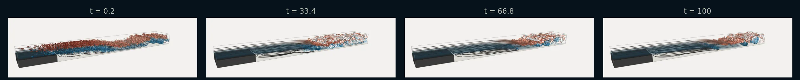

# Backward-Facing Step (2D & 3D)

!!! source "Source"

    - **Script:** [`backward_facing_step_sample.py`](https://github.com/tum-pbs/PICT/blob/main/backward_facing_step_sample.py)
    - **Setup:** adapted from the code of [INC: An Indirect Neural Corrector for Auto-Regressive Hybrid PDE Solvers](https://openreview.net/forum?id=s3Uk3lrfjy) (Wei et al., NeurIPS 2025)
    - **Run:** `python backward_facing_step_sample.py` from the repository root (2D; the 3D run is commented out at the end of the script)

A channel suddenly widens behind a step, and the flow separates at the step corner. The shear layer between the inflow jet and the recirculation zone below it becomes unstable and rolls up into vortices further downstream. The sample builds the channel from five blocks that are refined towards the step and the walls, and ends it with an outflow buffer. The same setup runs in 2D or, extruded with a periodic span, in 3D, where the 3D run starts from the developed 2D flow.

=== "Vorticity"

    <figure class="pict-media" markdown>
      <video autoplay loop muted playsinline poster="../../imgs/flows/bfs_vorticity_poster.webp">
        <source src="../../assets/videos/bfs_vorticity.mp4" type="video/mp4">
      </video>
      <figcaption>2D vorticity of the backward-facing step at Re = 1400 (blue: clockwise, red: counter-clockwise). The 40 × 2 channel is shown in two halves, x = 0–20 above x = 20–40; the step is the grey block. 1000 iterations of 0.1 time units with the settings of the sample, every second one shown. Simulated with PICT and rendered for this website.</figcaption>
    </figure>

=== "Passive scalar"

    <figure class="pict-media" markdown>
      <video autoplay loop muted playsinline poster="../../imgs/flows/bfs_smoke_poster.webp">
        <source src="../../assets/videos/bfs_smoke.mp4" type="video/mp4">
      </video>
      <figcaption>The passive scalar of the same 2D run. It enters with a Gaussian profile through the inflow and marks the separated shear layer. Simulated with PICT and rendered for this website.</figcaption>
    </figure>

**Setup** (default run of the sample)

- Inflow channel of height h = 1 and length 5, step height 1, channel of length 32 behind the step, outflow buffer of length 3
- 5 blocks with 18,432 cells (`res_scale=8`: 256 cells along the 32 units behind the step, 32 cells across each half of the height)
- Parabolic inflow with mean velocity 1, a Gaussian passive scalar profile at the inflow
- Re = 1400, based on the mean inflow velocity and the hydraulic diameter 2h of the inflow channel (viscosity 2/1400)
- 1000 iterations of 0.1 time units with adaptive sub-steps

## Grid

<figure markdown>
  
  
  <figcaption>The first 12 units of the grid, one color per block, every grid line drawn: the inflow channel (left), the two blocks behind the step, which meet at the step height. Drawn with the grid function of the sample by <code>scripts/viz_example_grids.py</code>.</figcaption>
</figure>

`make_BFS_grids` creates the blocks behind the step with `make_weights_ratio`, which fixes the ratio of the largest to the smallest cell independently of the resolution. With `ratio=(20,2)` the largest cell in x is 20× the smallest one, which is at the step. In y the cells shrink by a factor of 2 towards the walls and towards the step height. The inflow channel and the outflow buffer grow exponentially away from these blocks, starting from the size of the adjacent cells:

```python title="backward_facing_step_sample.py" linenums="100" hl_lines="2 3 10 11"
    # channel after the step, split at the height of the step
    Gtm = make_refined_ortho_grid(res_L, res_h, (xs[1],ys[1]), (xs[2],ys[2]), wall_refinement=["-x","-y","+y"], ratio=ratio, dtype=dtype)
    Gbm = make_refined_ortho_grid(res_L, res_y-res_h, (xs[1],ys[0]), (xs[2],ys[1]), wall_refinement=["-x","-y","+y"], ratio=ratio, dtype=dtype)

    # inflow channel and outflow buffer grow exponentially from the cell size of the connected block for a smooth transition
    weights_y_top = make_weights_ratio(res_h, ratio[1], "BOTH")
    weights_y_bot = make_weights_ratio(res_y-res_h, ratio[1], "BOTH")
    cell_x_first = (Gtm[0,0,0,1] - Gtm[0,0,0,0]).item()
    cell_x_last = (Gtm[0,0,0,-1] - Gtm[0,0,0,-2]).item()
    weights_x_in = shapes.make_weights_exp(res_l, base=growth_factor_from_sizes(res_l, l, cell_x_first), refinement="END")
    weights_x_out = shapes.make_weights_exp(res_buffer, base=growth_factor_from_sizes(res_buffer, buffer_length, cell_x_last), refinement="START")
```

## Blocks and boundaries

All outer faces start as walls, which includes the face of the step. Five connections join the blocks. For 3D, every block also becomes periodic in z, and the connections give the mapping for both tangential axes:

```python title="backward_facing_step_sample.py" linenums="171" hl_lines="4 5 6 18 19 20 21 22"
    # set boundaries
    # all outer boundaries are walls, in- and outflow are set below
    for block in blocks:
        block.CloseAllBoundaries()
        if dims==3:
            block.MakePeriodic("z")

    # connect the blocks
    # parameters are: block_from, side of block_from to connect, block_to, side of block_to to connect, axes
    # for 3D the axes are given for both remaining dimensions, in the order (y,z) for x-faces and (z,x) for y-faces
    if dims==2:
        Btl.ConnectBlock("+x", Btm, "-x", "-y")
        Btm.ConnectBlock("-y", Bbm, "+y", "-x")
        Btm.ConnectBlock("+x", Btr, "-x", "-y")
        Bbm.ConnectBlock("+x", Bbr, "-x", "-y")
        Btr.ConnectBlock("-y", Bbr, "+y", "-x")
    else:
        Btl.ConnectBlock("+x", Btm, "-x", "-y", "-z")
        Btm.ConnectBlock("-y", Bbm, "+y", "-z", "-x")
        Btm.ConnectBlock("+x", Btr, "-x", "-y", "-z")
        Bbm.ConnectBlock("+x", Bbr, "-x", "-y", "-z")
        Btr.ConnectBlock("-y", Bbr, "+y", "-z", "-x")
```

The inflow gets a parabolic velocity profile and a Gaussian scalar profile. The outflow faces at the end of the buffer get varying velocities and scalars, which the `PRE` callback advects out of the domain before every step with the mean velocity of the channel behind the step (see [Inflow and outflow](../guide/boundaries.md#inflow-and-outflow)). The profiles are computed from the cell centers of the 2D in- and outflow faces (`y_in`, `y_out`), and `to_boundary` turns them into boundary data (see [3D](#3d-a-periodic-span) below):

```python title="backward_facing_step_sample.py" linenums="207" hl_lines="3 7 8 18 22 30 31 32"
    # specify the inflow
    # parabolic (Poiseuille) profile with mean velocity in_vel, sampled at the cell centers of the inflow face
    inflow = 6*in_vel*(y_in/h)*(1 - y_in/h)
    Btl.getBoundary("-x").setVelocity(to_boundary(inflow, dims).to(cuda_device).contiguous())

    # passive scalar inflow
    inflow_scalar = shapes.get_grid_normal_dist([res_h], [0], [in_var], dtype=dtype)
    Btl.getBoundary("-x").setPassiveScalar(to_boundary(inflow_scalar, 1).to(cuda_device).contiguous())

    # also set up outflow boundaries at the end of the buffer.
    # these will need special treatment during the simulation
    # start with a parabolic profile over the full height, the mean velocity follows from mass conservation
    out_bounds = []
    for block, y in zip([Btr, Bbr], y_out):
        outflow = 6*in_vel*(h/H)*(y/H)*(1 - y/H)
        bound = block.getBoundary("+x")
        bound.setVelocity(to_boundary(outflow, dims).to(cuda_device).contiguous())
        bound.CreatePassiveScalar(False) # varying passive scalar for the outflow
        out_bounds.append(bound)

    # make the boundaries consistent/divergence-free
    PISOtorch_simulation.balance_boundary_fluxes(domain, out_bounds)

    # the outflow is advected with the mean velocity of the channel after the step
    in_flux = torch.sum(inflow * in_dy).item() # per unit depth
    char_vel = torch.tensor([[in_flux/H] + [0]*(dims-1)], device=cuda_device, dtype=dtype) # NC

    # callback function to update the outflow during the simulation
    out_bound_indices = [domain.getBlocks().index(Btr), domain.getBlocks().index(Bbr)]
    def prep_fn(domain, time_step, **kwargs):
        out_bounds = [domain.getBlock(idx).getBoundary("+x") for idx in out_bound_indices]
        PISOtorch_simulation.update_advective_boundaries(domain, out_bounds, char_vel, time_step.cuda())
```

### Optional damping in the outflow buffer

With `buffer_viscosity_ratio` > 1, the viscosity in the buffer blocks rises exponentially up to this factor over the first half of the buffer, which damps vortices before they reach the outflow. This uses a **per-cell viscosity** (see [Viscosity](../guide/physics.md#viscosity)). The default run leaves it off (`buffer_viscosity_ratio=1`); a run with a factor of 10 is commented out at the end of the script.

```python title="backward_facing_step_sample.py" linenums="194" hl_lines="7 12"
    if buffer_viscosity_ratio!=1:
        # per-cell viscosity in the outflow buffer: exponential increase over the first half, then constant
        for block in [Btr, Bbr]:
            size = block.getSizes()
            ramp = torch.linspace(0, 1, size.x//2, dtype=dtype)
            ramp = torch.cat([ramp, torch.ones([size.x - size.x//2], dtype=dtype)])
            block_viscosity = viscosity * torch.pow(buffer_viscosity_ratio, ramp)
            if dims==2:
                block_viscosity = block_viscosity.reshape([1,1,1,size.x]).expand(-1,-1,size.y,-1)
            else:
                block_viscosity = block_viscosity.reshape([1,1,1,1,size.x]).expand(-1,-1,size.z,size.y,-1)
            block.setViscosity(block_viscosity.to(cuda_device).contiguous())
```

## Running the simulation

The grids are orthogonal, so the non-orthogonal corrections are off. The initial field is projected to match the in- and outflow, and the outflow callback is only set afterwards, because the projection uses a time step of 1:

```python title="backward_facing_step_sample.py" linenums="318" hl_lines="1 2 4 11 14 15"
    sim = PISOtorch_simulation.Simulation(domain=domain, block_layout=layout, prep_fn=None,
            substeps="ADAPTIVE", time_step=time_step, corrector_steps=2, pressure_tol=1e-6,
            advect_non_ortho_steps=1, pressure_non_ortho_steps=1, pressure_return_best_result=True,
            velocity_corrector="FD", non_orthogonal=False,
            log_interval=1, norm_vel=True,
            output_resampling_shape=resample_shape, output_resampling_fill_max_steps=resample_fill_steps,
            log_dir=log_dir, save_domain_name="domain",
            stop_fn=STOP_FN)

    # initialize the domain with velocity that matches in- and outflow
    sim.make_divergence_free(max_iter=sim.linear_solve_max_iterations)

    # set the outflow update only after the initial projection, which uses a time step of 1
    sim.prep_fn = prep_fn
    sim.run(iterations)
```

The output images are resampled from the non-uniform blocks to a uniform grid (`output_resampling_shape`), with square pixels of the average cross-stream cell size (twice that in 3D). The script also contains commented runs at twice the resolution (`res_scale=16`) and with buffer damping. `res_scale` corresponds to 16/`downsample_factor` of the INC code. The paper's validation of the backward-facing step against reference data is shown on the [Validation](../background/validation.md#backward-facing-step) page.

## 3D: a periodic span

With `res_z` > 0, the sample runs in 3D over a periodic span of `depth` inflow heights:

```python title="backward_facing_step_sample.py" linenums="269" hl_lines="2 7 8 9 10"
def backward_facing_step_sample(log_dir, name, iterations=100, time_step=0.1, res_scale=8, Re=1400, step_height=1.0, buffer_viscosity_ratio=1,
        res_z=0, depth=4.0, load_2d_domain_path=None, dp=False, STOP_FN=None):
    # res_scale: resolution of the channel after the step in cells per inflow height h.
    #   The cross-stream resolution is 4x higher. res_scale=16/downsample_factor of the INC code.
    # Re: Reynolds number based on the mean inflow velocity and the hydraulic diameter of the inflow channel (2h)
    # step_height: step height relative to the inflow height h
    # res_z: number of span-wise cells for a 3D simulation with a periodic span of 'depth' (in units of h), 0 for 2D.
    #   res_z = res_scale*depth gives span-wise cells as large as the mean stream-wise cells after the step.
    # load_2d_domain_path: 3D only. Start from the developed flow of a 2D simulation of the same setup, e.g. '<run_dir>/domain'
    #   of a previous 2D run. It is copied to every span-wise position, with random noise to break the span-wise symmetry.
```

`make5BlockBackwardFacingStepSetup` computes the in- and outflow profiles on the 2D grids, then extrudes the grids from z = −depth/2 to depth/2. `to_boundary` reshapes a profile into the layout of the boundary data and, in 3D, repeats it over the span:

```python title="backward_facing_step_sample.py" linenums="140" hl_lines="3 9 10 14 17"
    # res_z: number of cells in span-wise direction for a 3D setup, 0 for 2D.
    #   The 2D grids are extruded from z=-depth/2 to z=depth/2 and the span-wise boundaries are periodic.
    dims = 3 if res_z>0 else 2
    assert len(grids)==5
    H = h + s
    Gtl, Gtm, Gbm, Gtr, Gbr = grids
    res_h = Gtl.size(-2)-1
    # in- and outflow profiles are set up on the 2D grids and repeated in span-wise direction
    y_in = shapes.coords_to_center_coords(Gtl)[0,1,:,0] - s
    y_out = [shapes.coords_to_center_coords(grid)[0,1,:,-1] for grid in (Gtr, Gbr)]
    in_dy = Gtl[0,1,1:,0] - Gtl[0,1,:-1,0]
    def to_boundary(profile, channels):
        # profile over the cells of a boundary in y -> NC[D]HW boundary data with 'channels' channels, the first one is the profile
        profile = profile.reshape([1,1,-1,1]) if dims==2 else profile.reshape([1,1,1,-1,1]).repeat(1,1,res_z,1,1)
        return torch.cat([profile] + [torch.zeros_like(profile)]*(channels-1), dim=1)
    if dims==3:
        Gtl, Gtm, Gbm, Gtr, Gbr = [shapes.extrude_grid_z(grid, res_z, start_z=-depth/2, end_z=depth/2) for grid in grids]
```

The 3D run starts from the developed 2D flow. `set_state_from_2D` copies a saved 2D domain to every span-wise position and adds random velocity to break the span-wise symmetry. Unlike `set_velocity_from_2D` of the [cylinder](cylinder_channel.md#3d-a-periodic-span) and [airfoil](airfoil_channel.md#3d-a-periodic-span) channels, it also copies the passive scalar, including the varying scalar of the outflow faces:

```python title="backward_facing_step_sample.py" linenums="244" hl_lines="10 11 13 20 21"
def set_state_from_2D(domain, domain_2d, noise:float=0.0, seed:int=None):
    # Initialize a 3D domain with the velocity and passive scalar of a 2D domain of the same setup, copied to every span-wise position.
    # The varying boundary values (outflow) are copied as well, an outflow that does not match the flow breaks the span-wise symmetry.
    # noise: standard deviation of random velocity added to break the span-wise symmetry
    generator = torch.Generator()
    if seed is not None:
        generator.manual_seed(seed)
    for block, block_2d in zip(domain.getBlocks(), domain_2d.getBlocks()):
        velocity = torch.zeros_like(block.velocity) # NCDHW
        velocity[:,:2] = block_2d.velocity.unsqueeze(2)
        velocity += noise*torch.randn(velocity.shape, generator=generator, dtype=velocity.dtype).to(velocity.device)
        block.setVelocity(velocity.contiguous())
        block.setPassiveScalar(block_2d.passiveScalar.unsqueeze(2).expand_as(block.passiveScalar).contiguous())
        for side in range(4): # x- and y-faces
            bound, bound_2d = block.getBoundary(side), block_2d.getBoundary(side)
            if isinstance(bound, PISOtorch.FixedBoundary) and not bound.isVelocityStatic:
                bound_velocity = torch.zeros_like(bound.velocity)
                bound_velocity[:,:2] = bound_2d.velocity.unsqueeze(2)
                bound.setVelocity(bound_velocity.contiguous())
            if isinstance(bound, PISOtorch.FixedBoundary) and bound.hasPassiveScalar() and not bound.isPassiveScalarStatic():
                bound.setPassiveScalar(bound_2d.passiveScalar.unsqueeze(2).expand_as(bound.passiveScalar).contiguous())
    domain.UpdateDomainData()
```

```python title="backward_facing_step_sample.py" linenums="307" hl_lines="5 6"
    domain, prep_fn, layout = make5BlockBackwardFacingStepSetup(grids, h=h, s=s, in_vel=in_vel, in_var=0.4, viscosity=viscosity,
        buffer_viscosity_ratio=buffer_viscosity_ratio, res_z=res_z, depth=depth*h, dtype=dtype)
    if load_2d_domain_path:
        LOG.info("velocity and passive scalar initialized from the 2D domain '%s'", load_2d_domain_path)
        domain_2d = domain_io.load_domain(load_2d_domain_path, dtype=dtype, device=cuda_device)
        set_state_from_2D(domain, domain_2d, noise=0.05*in_vel, seed=0)
        del domain_2d
```

The commented 3D run at the end of the script uses 32 span-wise cells over a span of 4h: 589,824 cells in total. It starts from the final domain of the default 2D run (t = 100) and simulates 500 iterations of 0.2 time units:

```python title="backward_facing_step_sample.py" linenums="354"
    # 3D with 32 cells over a periodic span of 4h (0.59M cells), starting from the developed 2D flow of the first run above
    #backward_facing_step_sample(run_dir, name="Re1400_r8_3D", res_scale=8, Re=1400, res_z=32, depth=4.0,
    #    load_2d_domain_path=os.path.join(run_dir, "0000_BFS_Re1400_r8", "domain"), iterations=500, time_step=0.2, dp=False, STOP_FN=stop_handler)
```

<figure class="pict-media" markdown>
  <video autoplay loop muted playsinline poster="../../imgs/flows/bfs3d_vortices_streamlines_poster.webp">
    <source src="../../assets/videos/bfs3d_vortices_streamlines.mp4" type="video/mp4">
  </video>
  <figcaption>The 3D run of the sample from the inflow to x = 28, over the 100 time units after the start from the 2D flow. The surfaces show where the Q-criterion equals 0.3 (U/h)², colored by the span-wise vorticity (blue: clockwise, red: counter-clockwise). A translucent volume of the span-wise vorticity shows the shear layer that separates at the step, where Q is still zero. The dark tubes are instantaneous streamlines from the inflow over the step and from the recirculation zone behind it. Every iteration of 0.2 time units is shown at 25 frames per second. Simulated with PICT, rendered for this website with vedo.</figcaption>
</figure>

<figure markdown>
  
  <figcaption>The same view at t = 0.2, 33.4, 66.8 and 100 after the start from the 2D flow. At first the span-wise rollers of the 2D flow fill the channel. Later the shear layer stays two-dimensional over the recirculation zone and breaks down into small three-dimensional vortices further downstream.</figcaption>
</figure>

In the second half of the run (t = 50 to 100 after the start), the root mean square of the span-wise velocity stays below 0.01, 1% of the mean inflow velocity, up to x = 13. It grows from there and is largest around x = 22–24, with up to 0.19 (computed from the recorded velocity of all cells).

??? info "How the videos were made"

    **2D:** `scripts/sim_flow_examples.py bfs` builds the domain with `make_BFS_grids` and `make5BlockBackwardFacingStepSetup` of the sample and runs it with the solver settings of the sample. A log callback records the vorticity and the scalar after every iteration. `scripts/render_flow_examples.py` interpolates the cell values to pixels and encodes the video. The color range is fixed for the whole run.

    **3D:** `scripts/sim_3d_examples.py bfs` runs `backward_facing_step_sample()` itself with the arguments of the commented 3D run, starting from the saved final domain of the default 2D run. A log callback records the velocity of all cells after every iteration. `scripts/render_3d_examples.py` interpolates it to a uniform grid with a spacing of 0.05, computes Q and the span-wise vorticity with central differences on that grid, and renders the surfaces, the volume and the streamlines with vedo. The streamlines are traced through the interpolated velocity from 21 points: 12 at x = 0.25 above the step and 9 at y = 0.3 at x = 7, 11 and 15. The 500 iterations took about 28 minutes on the RTX 3060 used for this website, including the recording.
