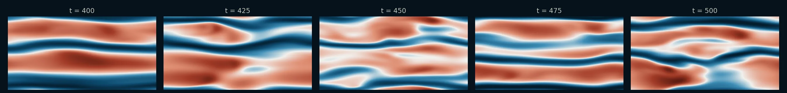

# Turbulent Channel Flow at Re<sub>τ</sub> = 180

!!! source "Source"

    - **Script:** [`turbulent_channel_flow_sample.py`](https://github.com/tum-pbs/PICT/blob/main/turbulent_channel_flow_sample.py)
    - **Setup:** adapted from the code of [FluidGym](https://openreview.net/forum?id=ilEooI8fK1) (Becktepe et al., ICML 2026), where it is the uncontrolled flow of the channel flow environments
    - **Run:** `python turbulent_channel_flow_sample.py` from the repository root (needs the [noise extension](../installation.md#optional-components) for the initial condition)

Fully developed turbulence between two parallel walls, in a small 3D channel of π × 2 × π/2 with 64<sup>3</sup> cells. The flow is periodic in the stream-wise and span-wise directions and is driven by a forcing that balances the wall shear stress. The channel flow of the paper, at Re<sub>τ</sub> = 550 with turbulence statistics and a learned SGS model, is described in [Turbulent Channel Flow SGS Model](turbulent_channel_flow.md).

=== "3D velocity fluctuations"

    <figure class="pict-media" markdown>
      <video autoplay loop muted playsinline poster="../../imgs/flows/tcf_volume_poster.webp">
        <source src="../../assets/videos/tcf_volume.mp4" type="video/mp4">
      </video>
      <figcaption>Stream-wise velocity fluctuations u′ in the whole channel (flow from left to right), scaled by their rms value at each height (blue: slower, red: faster than the mean). Values within ±1 rms are transparent. 100 time units (about 4 eddy turnover times) after the 400 iterations of the sample. Simulated with PICT, rendered for this website with vedo.</figcaption>
    </figure>

=== "Near-wall streaks"

    <figure class="pict-media" markdown>
      <video autoplay loop muted playsinline poster="../../imgs/flows/tcf_streaks_poster.webp">
        <source src="../../assets/videos/tcf_streaks.mp4" type="video/mp4">
      </video>
      <figcaption>The same run in the x–z plane at y<sup>+</sup> ≈ 14 above the lower wall: stream-wise velocity fluctuations in wall units (±6.5 u<sub>τ</sub>). The elongated low- and high-speed streaks are characteristic of wall turbulence. Simulated with PICT and rendered for this website.</figcaption>
    </figure>

<figure markdown>
  
  <figcaption>Near-wall streaks at t = 400, 425, 450, 475 and 500.</figcaption>
</figure>

**Setup** (default run of the sample)

- Channel of π × 2 × π/2 (stream-wise × wall-normal × span-wise), walls at y = ±1, periodic in x and z
- One block of 64 × 64 × 64 cells, refined towards both walls
- Target friction Reynolds number Re<sub>τ</sub> = 180, with the center-line velocity and the half-height as units
- Initial condition: Reichardt's mean profile with curl noise
- 400 iterations of 1.0 time units (ca. 17 eddy turnover times), adaptive sub-steps with a CFL number of 0.1. According to the script, the flow becomes turbulent after ca. 8 eddy turnover times.

## Grid and initial condition

`make_y_weights` places the vertices between the walls so that the cell size grows by a factor of 1.2<sup>N/2</sup> between neighbors (N = `refinement_strength`, 1 by default). The 2D grid is then extruded in z:

```python title="turbulent_channel_flow_sample.py" linenums="60" hl_lines="1 3 4"
    y_weights = make_y_weights(N=refinement_strength, ny_half=(res_y//2)*refinement_strength)
    corners = [(-length/2, -delta), (length/2, -delta), (-length/2, delta), (length/2, delta)]
    grid = shapes.generate_grid_vertices_2D([len(y_weights), res_x+1], corners, None, x_weights=y_weights, dtype=dtype)
    grid = shapes.extrude_grid_z(grid, res_z, start_z=-depth/2, end_z=depth/2)
```

The flow parameters follow from Re<sub>τ</sub>: `TCF_tools.Re_wall_to_cl` gives the center-line Reynolds number, which sets the viscosity and the friction velocity. A single block is closed in y; the other directions keep the default periodic boundaries. The initial velocity is Reichardt's law of the wall plus curl noise from the `SimplexNoiseVariations` extension:

```python title="turbulent_channel_flow_sample.py" linenums="84" hl_lines="3 4 5 15 18 23 24 25 26"
    dims = 3
    delta = 1
    Re_center = TCF_tools.Re_wall_to_cl(Re_wall)
    u_wall = Re_wall/Re_center # friction velocity
    viscosity = delta/Re_center

    grid = make_channel_grid(res_x, res_y, res_z, length, depth, delta=delta, refinement_strength=refinement_strength, dtype=dtype)

    viscosity = torch.ones([1], dtype=dtype, device=cpu_device)*viscosity
    domain = PISOtorch.Domain(dims, viscosity, passiveScalarChannels=0, name="DomainChannel", device=cuda_device, dtype=dtype)

    # create block from the mesh on the domain (missing settings, fields and transformation metrics are created automatically)
    block = domain.CreateBlock(vertexCoordinates=grid.to(cuda_device).contiguous(), name="BlockChannel")
    # closing -y also closes +y as they are connected via the default periodic boundary
    block.CloseBoundary("-y")

    # initial velocity: turbulent mean profile in x
    vel_init = make_reichardt_profile(domain, u_wall)
    vel_init = vel_init.view(1,1,1,res_y,1).expand(-1,-1,res_z,-1,res_x)
    vel_init = torch.cat([vel_init] + [torch.zeros_like(vel_init)]*(dims-1), dim=1)
    if init_with_noise:
        import SimplexNoiseVariations
        curl_noise = SimplexNoiseVariations.GenerateSimplexNoiseVariation([res_x,res_y,res_z], cuda_device, [2/res_x,2/res_y,2/res_z], [0]*3,
            SimplexNoiseVariations.NoiseVariation.CURL)
        curl_noise *= 0.5*vel_init/torch.max(torch.linalg.vector_norm(curl_noise, dim=1))
        vel_init = vel_init + curl_noise
    block.setVelocity(vel_init.to(dtype).contiguous())
```

Without the noise extension, pass `init_with_noise=False`. The flow then starts from the unperturbed mean profile.

## Driving the flow

A periodic channel needs a force to replace the pressure drop of a real channel. The sample computes the mean wall shear stress from the mean velocity of the first cells next to the walls, and sets it as a uniform stream-wise velocity source before every step. The forcing thus balances the friction at the walls, which keeps the mass flow rate constant according to the script (see [Velocity sources](../guide/physics.md#velocity-sources-forcing)):

```python title="turbulent_channel_flow_sample.py" linenums="116" hl_lines="12 16"
def make_dynamic_forcing_fn(domain, delta:float=1):
    # A stream-wise velocity source that balances the mean shear stress at the walls, set before every step.
    # Returns the callback and a function to compute the mean wall shear stress.
    dims = domain.getSpatialDims()
    pos_y = torch.mean(domain.getBlock(0).getCellCoordinates()[0,1], dim=(0,2))
    wall_distance = (delta + pos_y[0].item(), delta - pos_y[-1].item()) # distance of the first cell centers from the walls

    def get_wall_shear_stress(domain):
        block = domain.getBlock(0)
        mean_vel_u = torch.mean(block.velocity[0,0], dim=(0,2)) # mean over x and z
        viscosity = domain.viscosity.to(domain.getDevice())
        return (viscosity*mean_vel_u[0]/wall_distance[0] + viscosity*mean_vel_u[-1]/wall_distance[1])*0.5

    def dynamic_forcing_fn(domain, **kwargs):
        G = torch.cat([get_wall_shear_stress(domain).reshape([1,1]), torch.zeros([1,dims-1], dtype=domain.getDtype(), device=domain.getDevice())], dim=1) # NC
        domain.getBlock(0).setVelocitySource(G)

    return dynamic_forcing_fn, get_wall_shear_stress
```

The same wall shear stress gives the current friction Reynolds number, which the sample logs after every iteration to show whether the flow is turbulent:

```python title="turbulent_channel_flow_sample.py" linenums="184" hl_lines="3"
    def log_fn(domain, it, **kwargs):
        # the friction Reynolds number from the current wall shear stress shows if the flow is turbulent
        LOG.info("Re_tau at %.02f ETT: %.01f", TCF_tools.t_to_ETT(it*time_step, u_wall), np.sqrt(get_wall_shear_stress(domain).item())/viscosity)
```

In the run for the video, this value stayed between 173 and 192 (mean 183).

## Running the simulation

The advection uses BiCGStab with a tolerance of 10<sup>−6</sup>. The adaptive time stepping uses a small CFL number: according to the script, higher values can result in a laminar flow. Before the projection of the initial field, the sample calls `CopyVelocityResultFromBlocks`, which copies the block velocities into the domain's global velocity result buffer:

```python title="turbulent_channel_flow_sample.py" linenums="188" hl_lines="2 3 16 17"
    sim = PISOtorch_simulation.Simulation(domain=domain, prep_fn=prep_fn,
            substeps="ADAPTIVE", adaptive_CFL=adaptive_CFL, time_step=time_step, corrector_steps=2,
            advection_use_BiCG=True, advection_tol=1e-6, pressure_tol=1e-6,
            advect_non_ortho_steps=1, pressure_non_ortho_steps=1, pressure_return_best_result=True,
            velocity_corrector="FD", non_orthogonal=True,
            log_interval=1, norm_vel=True, log_fn=log_fn,
            output_resampling_shape=resample_shape, output_resampling_fill_max_steps=resample_fill_steps,
            log_dir=log_dir, save_domain_name="domain",
            stop_fn=STOP_FN)

    sim.preconditionBiCG = False
    sim.BiCG_precondition_fallback = True

    if not load_domain_path:
        # make the initial velocity divergence-free
        PISOtorch.CopyVelocityResultFromBlocks(domain)
        sim.make_divergence_free()
```

The transition to turbulence takes a while, so a run can continue from the saved domain of an earlier one with `load_domain_path`. The script also contains a commented run of the large channel (2π × 2 × π, 128 × 64 × 128 cells), as in the large channel flow environments of FluidGym:

```python title="turbulent_channel_flow_sample.py" linenums="220"
    # small channel (pi x 2 x pi/2) at Re_tau=180, 400 iterations are ca. 17 ETT
    turbulent_channel_flow_sample(run_dir, name="Re180_small", res_x=64, res_y=64, res_z=64, length=np.pi, depth=np.pi/2, Re_wall=180,
        iterations=400, time_step=1.0, dp=False, STOP_FN=stop_handler)

    # continue a previous simulation, e.g. after a warm-up
    #turbulent_channel_flow_sample(run_dir, name="Re180_small_continued", Re_wall=180, load_domain_path="./test_runs/<run_dir>/0000_channel_flow_Re180_small/domain",
    #    iterations=200, time_step=1.0, dp=False, STOP_FN=stop_handler)

    # large channel (2pi x 2 x pi) at Re_tau=180, as in the large channel flow environments of FluidGym
    #turbulent_channel_flow_sample(run_dir, name="Re180_large", res_x=128, res_y=64, res_z=128, length=2*np.pi, depth=np.pi, Re_wall=180,
    #    iterations=400, time_step=1.0, dp=False, STOP_FN=stop_handler)
```

For turbulence statistics and the validation of PICT on turbulent channel flow, see [Turbulent Channel Flow SGS Model](turbulent_channel_flow.md) and the [Validation](../background/validation.md#3d-turbulent-channel-flow) page.

??? info "How the videos were made"

    The sample ran its default 400 iterations (t = 0 to 400). `scripts/sim_flow_examples.py tcf` then continued from its saved final domain with the same setup and solver settings, but with an output time step of 0.25 for a smooth video: 400 iterations, t = 400 to 500. After every iteration, a log callback recorded the stream-wise velocity in an x–z plane near the wall and in the whole channel. `scripts/render_flow_examples.py` renders the plane. `scripts/render_tcf3d.py` interpolates the 3D field to a uniform grid and ray-casts it with vedo: the color and the opacity show u′ divided by its rms value at each height over the run.
