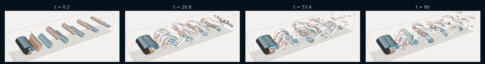

# Cylinder in a Channel (2D & 3D)

!!! source "Source"

    - **Script:** [`cylinder_channel_sample.py`](https://github.com/tum-pbs/PICT/blob/main/cylinder_channel_sample.py)
    - **Setup:** the channel benchmark of Schäfer & Turek (1996), scaled to a cylinder diameter of 1, adapted from the code of [FluidGym](https://openreview.net/forum?id=ilEooI8fK1) (Becktepe et al., ICML 2026), where it is the uncontrolled flow of the cylinder environments
    - **Run:** `python cylinder_channel_sample.py` from the repository root (2D; the 3D run is commented out at the end of the script)

A cylinder in a narrow channel with a parabolic inflow. The cylinder sits slightly below the center line, and this small asymmetry is enough to start the vortex shedding without any perturbation. Four blocks form an O-grid around the cylinder, and a fifth block covers the wake. The same setup runs in 2D or, extruded with a periodic span, in 3D, where the 3D run starts from the developed 2D flow.

<figure class="pict-media" markdown>
  <video autoplay loop muted playsinline poster="../../imgs/flows/cylinder_vorticity_poster.webp">
    <source src="../../assets/videos/cylinder_vorticity.mp4" type="video/mp4">
  </video>
  <figcaption>2D vorticity at Re = 100 in the full 22 × 4.1 channel (blue: clockwise, red: counter-clockwise), from t = 20, when the shedding starts, to t = 100. Every second iteration of 0.1 time units is shown. Simulated with PICT using the setup and solver settings of the sample, and rendered for this website.</figcaption>
</figure>

**Setup** (default run of the sample)

- Channel of length 22 and height 4.1 with no-slip walls; cylinder of diameter 1, its center 2 behind the inflow and 2.0 above the lower wall (2.1 below the upper wall)
- 5 blocks with 23,424 cells: 32 cells along each quarter of the cylinder surface (`res=32`)
- Parabolic inflow with mean velocity 1, advective outflow
- Re = 100, based on the cylinder diameter and the mean inflow velocity (viscosity 0.01)
- 1000 iterations of 0.1 time units with adaptive sub-steps. According to the script, the shedding starts after ca. 20 and is fully developed after ca. 45 time units.

## Grid

<figure markdown>
  { style="max-width: 36rem" }
  { style="max-width: 36rem" }
  <figcaption>The front part of the grid (x = −2 to 4), one color per block, every grid line drawn. Each of the four O-grid blocks joins a quarter ring around the cylinder with a straight-edged outer part; the wake block starts at x = 2. Drawn with the grid function of the sample by <code>scripts/viz_example_grids.py</code>.</figcaption>
</figure>

`make_cylinder_channel_grids` builds each O-grid block from two parts. The inner part is a quarter ring from `shapes.make_torus_2D`, which is flipped or transposed so that all blocks have the same orientation (y up, x right). The outer part runs from the ring to the channel walls, the inflow or the wake block. Its edge towards the ring follows the ring's outer border, and the right part uses the same y-refinement as the wake block, so that the cells match at the connection:

```python title="cylinder_channel_sample.py" linenums="66" hl_lines="3 4 5 6 7"
    # circular part, a quarter ring per grid
    # torus generation: angles in degree start at the x-axis and go counterclockwise, grid x goes along the angle, grid y from inner to outer radius
    ring_top = shapes.make_torus_2D(res, r1=cylinder_radius, r2=r_ring, start_angle=135, angle=-90, dtype=dtype) # y up, x right
    ring_right = shapes.make_torus_2D(res, r1=cylinder_radius, r2=r_ring, start_angle=45, angle=-90, dtype=dtype) # y right, x down
    ring_right = torch.flip(torch.movedim(ring_right, -1, -2), (-2,)) # y up, x right
    ring_bot = shapes.make_torus_2D(res, r1=cylinder_radius, r2=r_ring, start_angle=-45, angle=-90, dtype=dtype) # y down, x left
    ring_bot = torch.flip(ring_bot, (-2, -1)) # y up, x right
```

```python title="cylinder_channel_sample.py" linenums="92" hl_lines="1 2 5 6 7 8"
    quad_right = shapes.generate_grid_vertices_2D([res+1, res_quad], [(c, -c), (x_quad, y_bot), (c, c), (x_quad, y_top)],
        [make_border(ring_right[0,:,:,-1]), None, None, None], x_weights=wake_weights, dtype=dtype)

    # merge circular and outer parts, the shared vertices are only kept once
    grid_left = torch.cat([quad_left[...,:-1], ring_left], dim=-1)
    grid_top = torch.cat([ring_top[...,:-1,:], quad_top], dim=-2)
    grid_right = torch.cat([ring_right[...,:-1], quad_right], dim=-1)
    grid_bot = torch.cat([quad_bot[...,:-1,:], ring_bot], dim=-2)
```

## Blocks and boundaries

The cylinder wall is one face of each O-grid block. The connections close the ring and attach the wake block to the right block. Around the ring, an x-face of one block meets a y-face of the next, sometimes with the opposite direction. The last argument of `ConnectBlock` maps the tangential axis and its orientation (see [Connecting blocks](../guide/grids.md#connecting-blocks)). For 3D, every block becomes periodic in z, and the connections give the mapping for both tangential axes:

```python title="cylinder_channel_sample.py" linenums="136" hl_lines="3 4 5 6 13 14 26 27 28 29 30"
    # set boundaries
    # cylinder
    Bl.CloseBoundary("+x")
    Bt.CloseBoundary("-y")
    Br.CloseBoundary("-x")
    Bb.CloseBoundary("+y")
    # channel walls
    Bt.CloseBoundary("+y")
    Bb.CloseBoundary("-y")
    Bw.CloseBoundary("-y")
    Bw.CloseBoundary("+y")
    if dims==3:
        for block in [Bl, Bt, Br, Bb, Bw]:
            block.MakePeriodic("z")

    # connect the ring around the cylinder and the wake
    # parameters are: block_from, side of block_from to connect, block_to, side of block_to to connect, axes
    # for 3D the axes are given for both remaining dimensions, in the order (y,z) for x-faces and (z,x) for y-faces
    if dims==2:
        Bl.ConnectBlock("+y", Bt, "-x", "+y")
        Bl.ConnectBlock("-y", Bb, "-x", "-y")
        Br.ConnectBlock("+y", Bt, "+x", "-y")
        Br.ConnectBlock("-y", Bb, "+x", "+y")
        Br.ConnectBlock("+x", Bw, "-x", "-y")
    else:
        Bl.ConnectBlock("+y", Bt, "-x", "-z", "+y")
        Bl.ConnectBlock("-y", Bb, "-x", "-z", "-y")
        Br.ConnectBlock("+y", Bt, "+x", "-z", "-y")
        Br.ConnectBlock("-y", Bb, "+x", "-z", "+y")
        Br.ConnectBlock("+x", Bw, "-x", "-y", "-z")
```

The parabolic profiles are sampled at the face centers of the boundaries, from the vertex coordinates of the 2D grids (`inflow_y`, `outflow_y`). On the curved left block the cell centers are shifted towards the cylinder, so they would give a slightly wrong profile. The inflow and outflow are set by closing the faces with a prescribed velocity:

```python title="cylinder_channel_sample.py" linenums="167" hl_lines="13 17 19 22 25 26 27 28 29"
    def parabolic_profile(y):
        # parabolic (Poiseuille) profile over the full channel height with mean velocity in_vel, sampled at the face centers of a boundary.
        # y: vertex y-coordinates of the boundary (the cell centers are shifted towards the cylinder in the curved grid of the left block)
        y = 0.5*(y[1:] + y[:-1]) - y_bot
        u = 6*in_vel*(y/H)*(1 - y/H)
        if dims==2:
            u = u.reshape([1,1,-1,1])
        else:
            u = u.reshape([1,1,1,-1,1]).repeat(1,1,res_z,1,1)
        return torch.cat([u] + [torch.zeros_like(u)]*(dims-1), dim=1).to(cuda_device).contiguous()

    # specify the inflow
    Bl.CloseBoundary("-x", parabolic_profile(inflow_y))

    # also set up the outflow boundary at the end of the channel.
    # this will need special treatment during the simulation
    Bw.CloseBoundary("+x", parabolic_profile(outflow_y))
    out_bound = Bw.getBoundary("+x")
    out_bound.makeVelocityVarying()

    # make the boundaries consistent/divergence-free
    PISOtorch_simulation.balance_boundary_fluxes(domain, [out_bound])

    # callback function to update the outflow during the simulation
    char_vel = torch.tensor([[in_vel] + [0]*(dims-1)], device=cuda_device, dtype=dtype) # NC
    out_block_idx = domain.getBlocks().index(Bw)
    def prep_fn(domain, time_step, **kwargs):
        out_bounds = [domain.getBlock(out_block_idx).getBoundary("+x")]
        PISOtorch_simulation.update_advective_boundaries(domain, out_bounds, char_vel, time_step.cuda())
```

## Running the simulation

The O-grid is curvilinear, so the non-orthogonal corrections are on. The sample also enables the double-precision fallback of the linear solvers, and uses BiCGStab without a preconditioner, with the preconditioned solve as a fallback (see [Solver parameters](../guide/simulation.md#solver-parameters)):

```python title="cylinder_channel_sample.py" linenums="267" hl_lines="2 4 10 11 12 15 18 19"
    sim = PISOtorch_simulation.Simulation(domain=domain, block_layout=layout, prep_fn=None,
            substeps="ADAPTIVE", time_step=time_step, corrector_steps=2, pressure_tol=1e-5,
            advect_non_ortho_steps=1, pressure_non_ortho_steps=1, pressure_return_best_result=True,
            velocity_corrector="FD", non_orthogonal=True,
            log_interval=1, norm_vel=True,
            output_resampling_shape=resample_shape, output_resampling_fill_max_steps=resample_fill_steps,
            log_dir=log_dir, save_domain_name="domain",
            stop_fn=STOP_FN)

    sim.solver_double_fallback = True
    sim.preconditionBiCG = False
    sim.BiCG_precondition_fallback = True

    # initialize the domain with velocity that matches in- and outflow
    sim.make_divergence_free()

    # set the outflow update only after the initial projection, which uses a time step of 1
    sim.prep_fn = prep_fn
    sim.run(iterations)
```

The script contains commented runs at Re = 250 and Re = 500, as in the medium and hard cylinder environments of FluidGym. According to the script, FluidGym uses `res=24` for Re = 100 and `res=32` for Re = 250 and 500; the sample uses 32 for all three. For a cylinder in an open domain, see the ring grid of the [Vortex Street](vortex_street.md) example.

## 3D: a periodic span

With `res_z` > 0, the sample runs in 3D over a periodic span of 4 cylinder diameters:

```python title="cylinder_channel_sample.py" linenums="223" hl_lines="4 5 6"
def cylinder_channel_sample(log_dir, name, iterations=100, time_step=0.1, res=32, Re=100, res_z=0, load_2d_domain_path=None, dp=False, STOP_FN=None):
    # res: number of cells along a quarter of the cylinder surface. FluidGym uses 24 for Re=100 and 32 for Re 250 and 500.
    # Re: Reynolds number based on the cylinder diameter and the mean inflow velocity
    # res_z: number of span-wise cells for a 3D simulation with a span of 4 (FluidGym's 3D cylinder environments use res), 0 for 2D
    # load_2d_domain_path: 3D only. Start from the developed flow of a 2D simulation of the same setup, e.g. '<run_dir>/domain'
    #   of a previous 2D run. It is copied to every span-wise position, with random noise to break the span-wise symmetry.
```

`make5BlockCylinderChannelSetup` takes the y-coordinates of the in- and outflow faces from the 2D grids, then extrudes the grids from z = −2 to 2. `parabolic_profile` above repeats the profiles over the span:

```python title="cylinder_channel_sample.py" linenums="108" hl_lines="7 11 12 14"
def make5BlockCylinderChannelSetup(grids, in_vel:float=1.0, viscosity:float=0.0, res_z:int=0, depth:float=4.0, dtype=torch.float32):
    # grids: the 2D coordinate grids to make the blocks from, as generated by make_cylinder_channel_grids
    # in_vel: mean velocity of the parabolic inflow profile
    # viscosity: viscosity of the flow
    # res_z: number of cells in span-wise direction for a 3D setup, 0 for 2D.
    #   The 2D grids are extruded from z=-depth/2 to z=depth/2 and the span-wise boundaries are periodic.
    dims = 3 if res_z>0 else 2
    assert len(grids)==5
    y_bot = grids[0][0,1,0,0].item()
    H = grids[0][0,1,-1,0].item() - y_bot
    inflow_y = grids[0][0,1,:,0]
    outflow_y = grids[4][0,1,:,-1]
    if dims==3:
        grids = [shapes.extrude_grid_z(grid, res_z, start_z=-depth/2, end_z=depth/2) for grid in grids]
    Gl, Gt, Gr, Gb, Gw = grids
```

The 3D run starts from the developed 2D flow. `set_velocity_from_2D` is the same function as in the [airfoil channel](airfoil_channel.md#3d-a-periodic-span): it copies a saved 2D domain to every span-wise position, including the varying outflow velocities, and adds random noise to break the span-wise symmetry:

```python title="cylinder_channel_sample.py" linenums="257" hl_lines="4 5"
    domain, prep_fn, layout = make5BlockCylinderChannelSetup(grids, in_vel=in_vel, viscosity=viscosity, res_z=res_z, depth=depth, dtype=dtype)
    if load_2d_domain_path:
        LOG.info("velocity initialized from the 2D domain '%s'", load_2d_domain_path)
        domain_2d = domain_io.load_domain(load_2d_domain_path, dtype=dtype, device=cuda_device)
        set_velocity_from_2D(domain, domain_2d, noise=0.025, seed=0) # noise as in the initialization of FluidGym's cylinder environments
        del domain_2d
```

The commented 3D run at the end of the script runs at Re = 250 with 32 span-wise cells: 749,568 cells in total. It starts from the final domain of the commented 2D run at Re = 250 (t = 100) and simulates 400 iterations of 0.2 time units. According to the comment, the wake stays two-dimensional at Re = 100:

```python title="cylinder_channel_sample.py" linenums="306"
    # 3D with 32 cells over a periodic span of 4 (0.75M cells), as in the medium 3D cylinder environment of FluidGym,
    # starting from the developed 2D flow of the Re=250 run above (uncomment it). At Re=100 the wake stays two-dimensional.
    #cylinder_channel_sample(run_dir, name="Re250_r32_3D", res=32, Re=250, res_z=32,
    #    load_2d_domain_path=os.path.join(run_dir, "0001_cylinder_channel_Re250_r32", "domain"), iterations=400, time_step=0.2, dp=False, STOP_FN=stop_handler)
```

=== "Vortex surfaces"

    <figure class="pict-media" markdown>
      <video autoplay loop muted playsinline poster="../../imgs/flows/cylinder3d_vortices_poster.webp">
        <source src="../../assets/videos/cylinder3d_vortices.mp4" type="video/mp4">
      </video>
      <figcaption>The 3D run of the sample at Re = 250 in the full channel, over the 80 time units after the start from the 2D flow. The surfaces show where the Q-criterion equals 1 (U/D)², colored by the span-wise vorticity (blue: clockwise, red: counter-clockwise). Every iteration of 0.2 time units is shown at 25 frames per second. Simulated with PICT, rendered for this website with vedo.</figcaption>
    </figure>

=== "Vorticity volume"

    <figure class="pict-media" markdown>
      <video autoplay loop muted playsinline poster="../../imgs/flows/cylinder3d_volume_poster.webp">
        <source src="../../assets/videos/cylinder3d_volume.mp4" type="video/mp4">
      </video>
      <figcaption>Span-wise vorticity of the same run as a ray-cast volume, with the color range of the vortex surfaces (±19). It is transparent where the magnitude is below 1.9 and nearly opaque above 3. The boundary layers of the cylinder and the channel walls are left out. Simulated with PICT, rendered for this website with vedo.</figcaption>
    </figure>

<figure markdown>
  
  <figcaption>Vortex surfaces at t = 0.2, 26.8, 53.4 and 80 after the start from the 2D flow. The span-wise rollers of the 2D wake break up into three-dimensional vortices. White surfaces have little span-wise vorticity: their axes point in other directions.</figcaption>
</figure>

??? info "How the videos were made"

    **2D:** `scripts/sim_flow_examples.py cylinder` builds the domain with the grid and setup functions of the sample and runs it with the solver settings of the sample. After every iteration, a log callback records the vorticity, computed from the circulation around each cell (`vizlib.CirculationVorticity2D`). Unlike per-block finite differences, this does not show jumps where the grid lines of connected blocks change direction. `scripts/render_flow_examples.py` interpolates the cell values to pixels, masks the cylinder and encodes the video with a fixed color range.

    **3D:** `scripts/sim_3d_examples.py cylinder` runs `cylinder_channel_sample()` itself with the arguments of the commented 3D run, starting from the saved final domain of the 2D run at Re = 250 (1000 iterations of 0.1). A log callback records the velocity of all cells after every iteration. `scripts/render_3d_examples.py` interpolates it to a uniform grid with a spacing of 0.05 and computes Q and the span-wise vorticity with central differences on that grid. The boundary layers are thinner than this grid, so Q is left out within two grid spacings of the cylinder and three of the channel walls. The 400 iterations took about 35 minutes on the RTX 3060 used for this website, including the recording.
