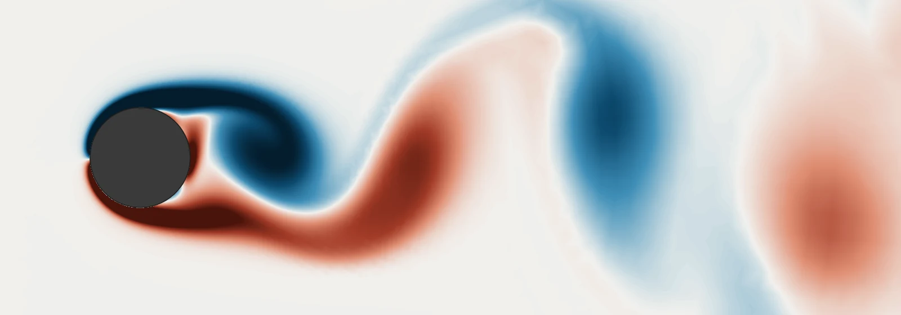
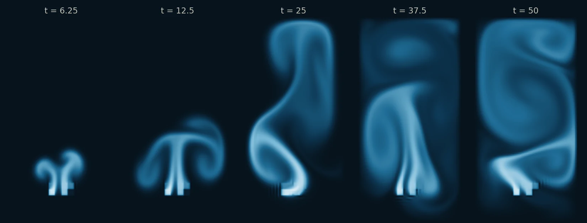
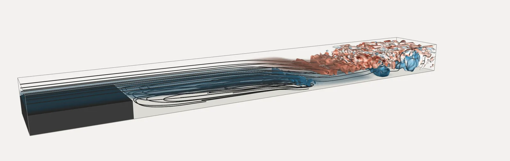
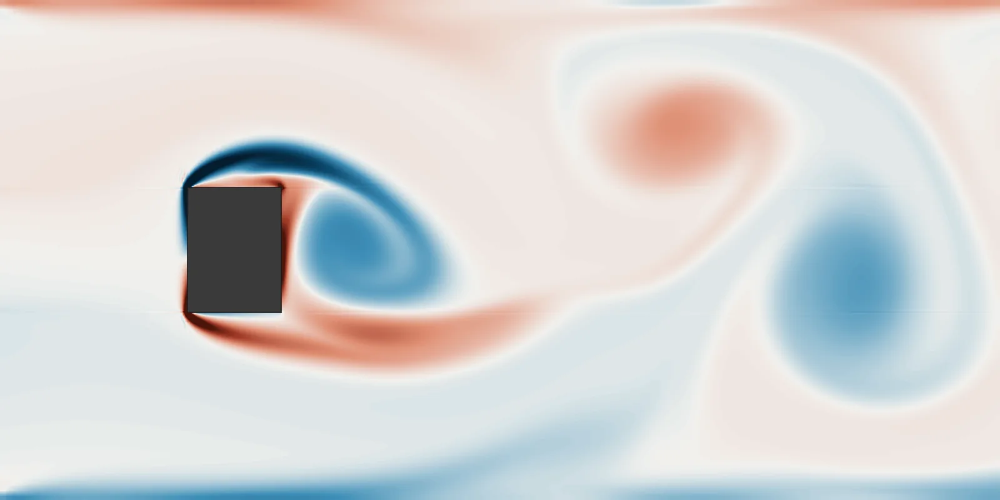
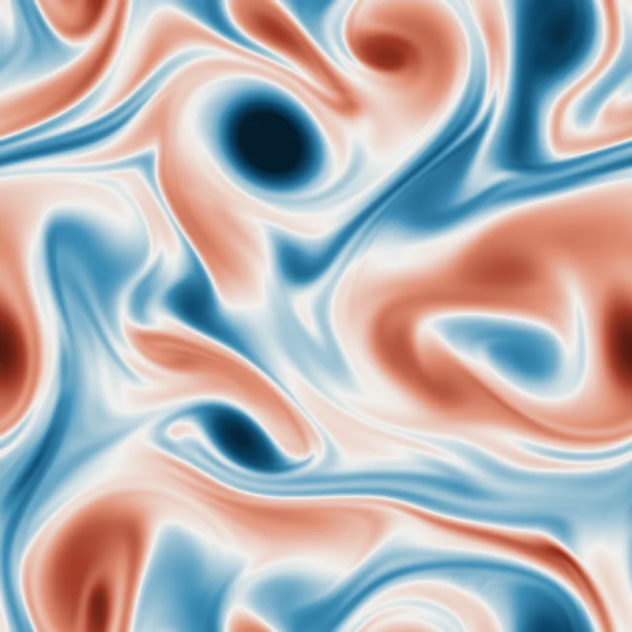
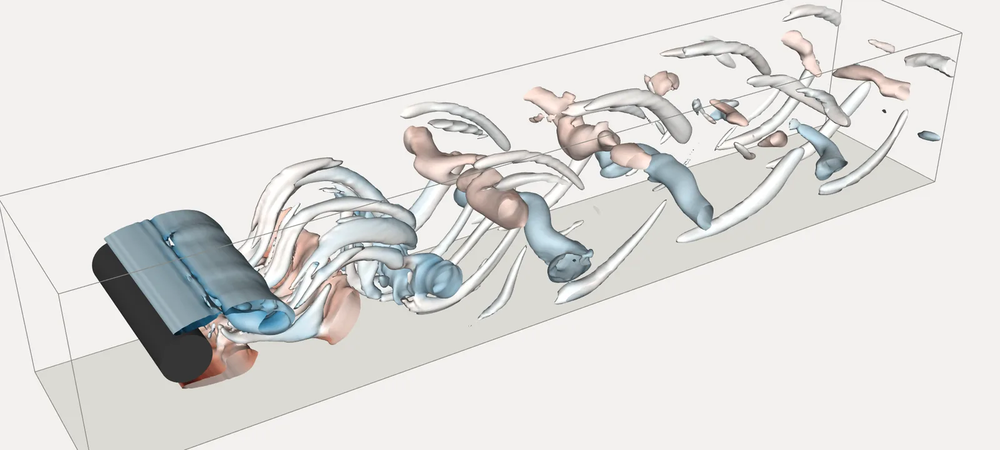
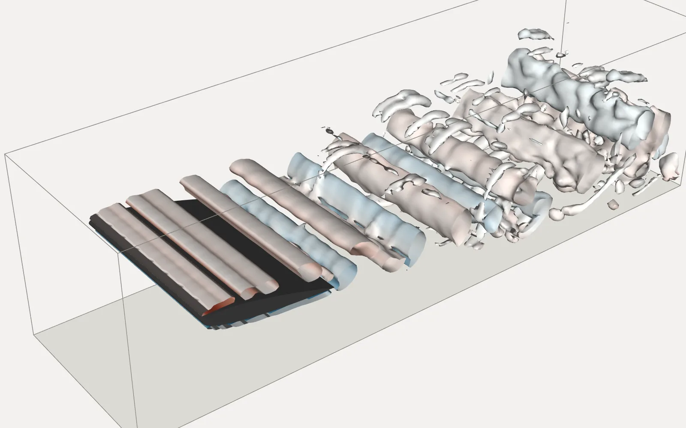
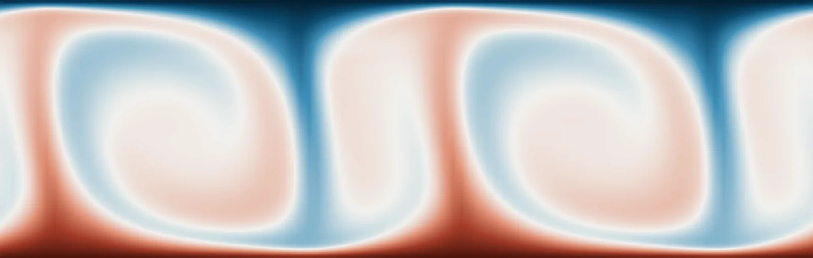
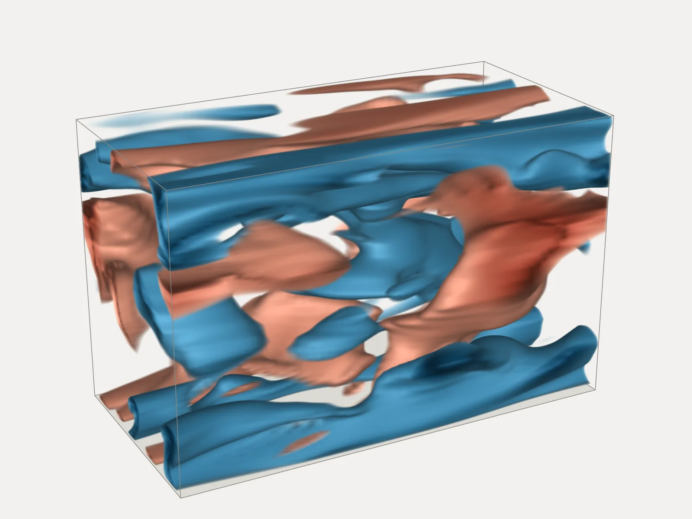

# Examples

The PICT repository ships with sample scripts that range from a 90-line "hello world" to the full turbulence-learning setup of the paper. The examples in this section walk through the most instructive ones. Each page starts with a **Source** box that names the script and the origin of its setup. The code excerpts are verbatim copies of the scripts, with their line numbers. All visuals on these pages were produced with the solver: the flow fields and charts were rendered for this website with the current code, and the figures marked as such come from the paper.

## Basic setups and learning

-   **[Lid-Driven Cavity](lid_driven_cavity.md)**

    ---

    
    

    The minimal setup: one wall-refined block, a moving lid, adaptive time stepping. 2D and 3D.

-   **[Vortex Street](vortex_street.md)**

    ---

    { .thumb-left }

    Flow around a cylinder on a 4-block ring grid with inflow, advective outflow and an optional rotating obstacle.

-   **[NACA 0012 Airfoil](airfoil.md)**

    ---

    
    

    A 3-block C-grid around an airfoil, interpolated from its border curves, with flipped block connections.

-   **[Buoyant Plume](buoyancy.md)**

    ---

    

    A passive scalar couples back into the flow through callbacks: smoke inflow, a buoyancy force and clamping.

-   **[Learning a Forcing](learning_forcing.md)**

    ---

    { .thumb-contain }
    { .thumb-contain }

    Gradient descent through the differentiable solver recovers an unknown forcing, and a CNN learns to predict it.

-   **[Turbulent Channel Flow SGS Model](turbulent_channel_flow.md)**

    ---

    { .on-white }

    The paper's flagship experiment: a 3D SGS model trained only on turbulence statistics.

## Benchmark flows

Eight further forward-simulation samples, on seven pages, set up common benchmark flows. The backward-facing step and the Kármán vortex street are adapted from the code of [INC](https://openreview.net/forum?id=s3Uk3lrfjy) (Wei et al., NeurIPS 2025). The cylinder, airfoil, Rayleigh–Bénard and channel flows are the uncontrolled flows of the [FluidGym](https://openreview.net/forum?id=ilEooI8fK1) environments (Becktepe et al., ICML 2026).

-   **[Backward-Facing Step (2D & 3D)](backward_facing_step.md)**

    ---

    

    A 5-block channel behind a step with an outflow buffer, in 2D and extruded to a periodic 3D span with 0.59 million cells. Re = 1400.

-   **[Kármán Vortex Street in a Channel](karman_vortex_street.md)**

    ---

    

    A rectangular obstacle on an 8-block grid refined towards it, with a perturbation that triggers the shedding. Re = 600.

-   **[Decaying & Kolmogorov Turbulence](periodic_turbulence.md)**

    ---

    

    2D turbulence on a periodic block from a random spectral field, freely decaying or driven by a forcing callback. The decaying turbulence also runs in 3D.

-   **[Cylinder in a Channel (2D & 3D)](cylinder_channel.md)**

    ---

    

    The Schäfer & Turek benchmark on a 5-block O-grid: parabolic inflow, advective outflow. 2D at Re = 100, 3D with a periodic span at Re = 250.

-   **[Airfoil in a Channel (2D & 3D)](airfoil_channel.md)**

    ---

    

    NACA 0012 at 10° on a 6-block grid, in 2D and extruded to a periodic 3D span with 4.5 million cells. Re = 3000.

-   **[Rayleigh–Bénard Convection (2D & 3D)](rayleigh_benard.md)**

    ---

    

    Temperature as a passive scalar with its own diffusivity, buoyancy through a callback, Nusselt number. 2D and 3D, Ra = 8·105.

-   **[Turbulent Channel Flow (Reτ = 180)](channel_flow_re180.md)**

    ---

    

    3D wall turbulence in a small periodic channel, driven by a forcing that balances the wall shear stress.

## All sample scripts

| Script | What it shows |
|---|---|
| `minimal_lid_sample.py` | 2D lid-driven cavity on a single wall-refined block; **start here** |
| `minimal_lid_sample3D.py` | the same cavity extruded to 3D |
| `buoyancy_sample.py` | passive scalar transport and a buoyancy force via callbacks |
| `vortex_street_torus_sample.py` | cylinder on a 4-block ring grid, inflow, advective outflow, rotating obstacle; 2D or 3D |
| `vortex_street_sample.py` | channel with a square obstacle built from 8 blocks; periodic or closed walls; scalar inflow |
| `vortex_street_refined_sample.py` | the 8-block obstacle channel with graded refinement around the obstacle |
| `airfoil_sample.py` | NACA 0012 airfoil on a 3-block C-grid |
| `test_BFS.py` | 2D backward-facing step on 3 refined blocks |
| `backward_facing_step_sample.py` | backward-facing step on 5 refined blocks with an outflow buffer; 2D or 3D with a periodic span (from INC) |
| `karman_vortex_street_sample.py` | rectangular obstacle in a closed channel on 8 refined blocks, wake perturbation (from INC) |
| `decaying_turbulence_sample.py` | decaying turbulence in a periodic box, 2D or 3D |
| `kolmogorov_flow_sample.py` | 2D Kolmogorov flow: sinusoidal forcing with linear damping |
| `cylinder_channel_sample.py` | Schäfer & Turek cylinder channel on a 5-block O-grid; 2D or 3D with a periodic span (from FluidGym) |
| `airfoil_channel_sample.py` | NACA 0012 in a channel on 6 blocks, 2D or 3D with a periodic span (from FluidGym) |
| `rayleigh_benard_sample.py` | Rayleigh–Bénard convection in 2D or 3D, temperature as a buoyant passive scalar (from FluidGym) |
| `turbulent_channel_flow_sample.py` | 3D turbulent channel flow at Reτ = 180 in a small channel (from FluidGym) |
| `circle_square_grid.py` | grid generation only: a cylinder inside a square from 8 blocks |
| `learning_sample.py` | optimize a forcing and train a forcing network through the solver |
| `channel_flow_sim.py` | turbulent channel flow at Reτ = 550: validation runs and training data |
| `channel_flow_learning.py` | statistics-based training of the channel-flow SGS model |
| `run_tests.py`, `run_validations.py` | test suite and physical validation cases |

All scripts are meant to be run from the repository root and write their output to `./test_runs/<timestamp>_<name>/`. Most of them pick the least-used GPU automatically and can be stopped gracefully with Ctrl-C.
