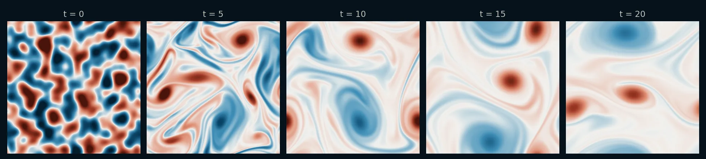
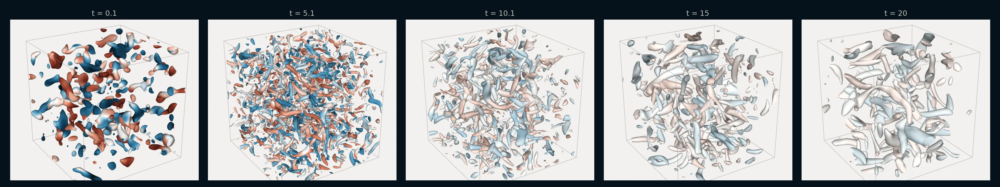
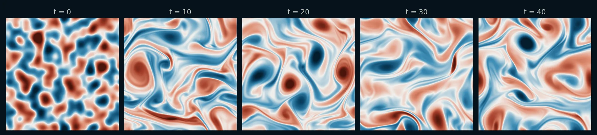

# Decaying & Kolmogorov Turbulence

!!! source "Source"

    - **Scripts:** [`decaying_turbulence_sample.py`](https://github.com/tum-pbs/PICT/blob/main/decaying_turbulence_sample.py) and [`kolmogorov_flow_sample.py`](https://github.com/tum-pbs/PICT/blob/main/kolmogorov_flow_sample.py)
    - **Setup:** periodic 2D turbulence, and decaying turbulence in 3D; the initial field is generated like JAX-CFD's `filtered_velocity_field` (according to the scripts)
    - **Run:** `python decaying_turbulence_sample.py` or `python kolmogorov_flow_sample.py` from the repository root (the 3D run is commented out at the end of `decaying_turbulence_sample.py`)

Two classic 2D turbulence setups on a single periodic block of 256 × 256 cells covering [0, 2π]². Both start from the same kind of random, divergence-free velocity field. In **decaying turbulence** nothing drives the flow, and the vortices merge into fewer and larger ones while the energy dissipates. In **Kolmogorov flow** a sinusoidal shear force keeps the turbulence going, and a linear damping removes the energy that collects in the largest scales. The forcing is a velocity source that a callback updates before every step. The decaying turbulence also runs [in 3D](#3d-decaying-turbulence), in a periodic cube of 128³ cells.

<div class="grid" markdown>

<figure class="pict-media" markdown>
  <video autoplay loop muted playsinline poster="../../imgs/flows/decaying_vorticity_poster.webp">
    <source src="../../assets/videos/decaying_vorticity.mp4" type="video/mp4">
  </video>
  <figcaption><strong>Decaying turbulence</strong>: vorticity from t = 0 to 20, the 200 iterations of the sample.</figcaption>
</figure>

<figure class="pict-media" markdown>
  <video autoplay loop muted playsinline poster="../../imgs/flows/kolmogorov_vorticity_poster.webp">
    <source src="../../assets/videos/kolmogorov_vorticity.mp4" type="video/mp4">
  </video>
  <figcaption><strong>Kolmogorov flow</strong>: vorticity from t = 10 to 40. The run is twice as long as the sample's 200 iterations, because the turbulence takes time to develop.</figcaption>
</figure>

</div>

Both videos show every iteration of 0.1 time units at 20 frames per second, with a fixed color range for the whole run (blue: clockwise, red: counter-clockwise). They were simulated with PICT using the setup functions and solver settings of the samples and rendered for this website.

## Random initial velocity

`make_filtered_velocity_field` filters white noise with a log-normal spectral density that peaks at `peak_wavenumber`. It then removes the divergent part in Fourier space and scales the field to the maximum velocity `max_velocity`. With `dims=3` the same steps run on a 3D grid of wavenumbers:

```python title="decaying_turbulence_sample.py" linenums="26" hl_lines="8 15 20 21 23"
def make_filtered_velocity_field(res:int, domain_size:float, max_velocity:float, peak_wavenumber:float, dims:int=2, seed:int=None, dtype=torch.float32):
    # Random divergence-free velocity field with most energy around 'peak_wavenumber', like JAX-CFD's filtered_velocity_field:
    # white noise is filtered with a log-normal spectral density, the divergent part is removed, and it is scaled to 'max_velocity'.
    # dims: 2 or 3 spatial dimensions, the field has res cells per axis
    generator = torch.Generator()
    if seed is not None:
        generator.manual_seed(seed)
    noise = torch.randn([dims] + [res]*dims, generator=generator, dtype=torch.float64) # C[D]HW
    k_axis = 2*np.pi*torch.fft.fftfreq(res, d=domain_size/res, dtype=torch.float64) # angular wavenumbers
    k = torch.meshgrid(*[k_axis]*dims, indexing="ij")[::-1] # k_x, k_y[, k_z]
    k_mag = torch.sqrt(sum(k_i**2 for k_i in k))
    k_mag[(0,)*dims] = 1 # avoid division by 0, the mean is removed below
    # log-normal spectral density with mode peak_wavenumber and log-variance 0.25, divided by k**(dims-1)
    log_k = torch.log(k_mag)
    spectral_filter = torch.exp(-(np.log(peak_wavenumber) + 0.25 - log_k)**2/(2*0.25) - log_k) / k_mag**(dims-1)
    spectral_filter[(0,)*dims] = 0
    fft_dims = tuple(range(1, dims+1))
    vel_hat = torch.fft.fftn(noise, dim=fft_dims) * spectral_filter
    # projection to divergence-free
    k_dot_vel = sum(k_i*vel_hat_i for k_i, vel_hat_i in zip(k, vel_hat)) / k_mag**2
    vel_hat = torch.stack([vel_hat_i - k_i*k_dot_vel for k_i, vel_hat_i in zip(k, vel_hat)])
    velocity = torch.fft.ifftn(vel_hat, dim=fft_dims).real
    velocity = velocity * (max_velocity/torch.max(torch.linalg.vector_norm(velocity, dim=0)))
    return velocity.reshape([1, dims] + [res]*dims).to(dtype) # NC[D]HW
```

The field is divergence-free in the spectral sense. Before the run, `sim.make_divergence_free()` projects it again, so that it is also divergence-free for the finite-volume discretization of the solver.

## A periodic block

Block boundaries are periodic by default, so the domain is a single block with no further boundary setup. The number of dimensions follows from the shape of the velocity, and in 3D the square grid is extruded to a cube:

```python title="decaying_turbulence_sample.py" linenums="51" hl_lines="6 8 10 16"
def makePeriodicTurbulenceDomain(res:int, domain_size:float, viscosity:float, velocity:torch.Tensor, dtype=torch.float32):
    # single block with uniform grid, all boundaries are periodic
    # res: number of cells per axis
    # domain_size: physical size of the square (cubic in 3D) domain
    # velocity: initial velocity, NC[D]HW with spatial shape (res, res[, res]), its shape sets the dimensionality
    dims = velocity.dim() - 2

    grid = shapes.make_wall_refined_ortho_grid(res, res, corner_upper=(domain_size, domain_size), wall_refinement=[], dtype=dtype)
    if dims==3:
        grid = shapes.extrude_grid_z(grid, res, start_z=0, end_z=domain_size)

    viscosity = torch.ones([1], dtype=dtype, device=cpu_device)*viscosity
    domain = PISOtorch.Domain(dims, viscosity, passiveScalarChannels=0, name="DomainTurbulence", device=cuda_device, dtype=dtype)

    # boundaries are periodic by default
    domain.CreateBlock(velocity=velocity.to(cuda_device).contiguous(), vertexCoordinates=grid.to(cuda_device).contiguous(), name="BlockTurbulence")

    domain.PrepareSolve()

    return domain
```

`kolmogorov_flow_sample.py` contains 2D-only versions of the same two functions.

## Decaying turbulence

The default run uses a viscosity of 10<sup>−3</sup>, an initial maximum velocity of 4.2 at peak wavenumber 4 (seed 0), and 200 iterations of 0.1 time units. The adaptive sub-steps use a CFL number of 0.5:

```python title="decaying_turbulence_sample.py" linenums="93" hl_lines="1 2 5"
    velocity = make_filtered_velocity_field(res, domain_size, max_velocity, peak_wavenumber, dims=dims, seed=seed, dtype=dtype)
    domain = makePeriodicTurbulenceDomain(res, domain_size, viscosity, velocity, dtype=dtype)

    sim = PISOtorch_simulation.Simulation(domain=domain, prep_fn=None,
            substeps="ADAPTIVE", adaptive_CFL=0.5, time_step=time_step, corrector_steps=2, pressure_tol=1e-6,
            advect_non_ortho_steps=1, pressure_non_ortho_steps=1, pressure_return_best_result=True,
            velocity_corrector="FD", non_orthogonal=False,
            log_interval=1, norm_vel=True,
            log_dir=log_dir, save_domain_name="domain",
            stop_fn=STOP_FN)
```

<figure markdown>
  
  <figcaption>Vorticity of the decaying turbulence at t = 0, 5, 10, 15 and 20.</figcaption>
</figure>

A commented call in the script runs the same setup at 512 × 512.

### 3D decaying turbulence

With `dims=3`, the same functions set up a periodic cube [0, 2π]³. The commented 3D run uses 128³ cells (2.1 million) and a higher viscosity; the other parameters and the solver settings are those of the 2D run:

```python title="decaying_turbulence_sample.py" linenums="128"
    # 3D with 128^3 cells. The viscosity is higher than in 2D to resolve the smallest eddies of the energy cascade,
    # the kinetic energy decays to ca. 3% of its initial value in 10 and to 1% in 20 time units
    #decaying_turbulence_sample(run_dir, name="3D_r128_visc3e-3", dims=3, res=128, viscosity=3e-3, iterations=200, time_step=0.1, dp=False, STOP_FN=stop_handler)
```

In the run for the videos, the mean kinetic energy fell to 2.5% of its value after the first iteration by t = 10, and to 0.9% by t = 20.

=== "Vortex surfaces"

    <figure class="pict-media" markdown>
      <video autoplay loop muted playsinline poster="../../imgs/flows/decaying3d_vortices_poster.webp">
        <source src="../../assets/videos/decaying3d_vortices.mp4" type="video/mp4">
      </video>
      <figcaption>The 3D run of the sample from t = 0 to 20. The surfaces show where the Q-criterion equals the current mean enstrophy ⟨|ω|²⟩/2, which decays by more than two orders of magnitude, colored by the z-vorticity with a fixed color range (blue: negative, red: positive). Every iteration of 0.1 time units is shown at 20 frames per second. Simulated with PICT, rendered for this website with vedo.</figcaption>
    </figure>

=== "Vorticity volume"

    <figure class="pict-media" markdown>
      <video autoplay loop muted playsinline poster="../../imgs/flows/decaying3d_volume_poster.webp">
        <source src="../../assets/videos/decaying3d_volume.mp4" type="video/mp4">
      </video>
      <figcaption>The z-vorticity of the same run as a ray-cast volume, divided by its current root mean square (blue: negative, red: positive). It is transparent below 2 and nearly opaque above 2.3 times the root mean square. Simulated with PICT, rendered for this website with vedo.</figcaption>
    </figure>

<figure markdown>
  
  <figcaption>Vortex surfaces at t = 0.1, 5.1, 10.1, 15 and 20. The random initial field first forms many thin vortex tubes. Later the tubes become fewer and thicker, and their colors fade as the vorticity decays.</figcaption>
</figure>

## Kolmogorov flow

The forcing is \(\mathbf{f} = (4\sin(4y),\, 0) - 0.1\,\mathbf{u}\). The sinusoidal part is fixed, while the damping term depends on the current velocity. A `PRE` callback therefore sets the whole term as velocity source before every step (see [Velocity sources](../guide/physics.md#velocity-sources-forcing) and [Callbacks](../guide/simulation.md#callbacks)):

```python title="kolmogorov_flow_sample.py" linenums="69" hl_lines="5 10"
def make_kolmogorov_forcing_fn(domain, forcing_scale:float, forcing_wavenumber:float, linear_damping:float):
    # Kolmogorov forcing f = (forcing_scale*sin(forcing_wavenumber*y), 0) + linear_damping*velocity, set as velocity source.
    # The (negative) linear damping removes the energy that accumulates in the large scales due to the inverse energy cascade of 2D turbulence.
    cell_coords = shapes.coords_to_center_coords(domain.getBlock(0).vertexCoordinates) # forcing is evaluated at the cell centers
    forcing_x = forcing_scale*torch.sin(forcing_wavenumber*cell_coords[:,1:2])
    forcing = torch.cat([forcing_x, torch.zeros_like(forcing_x)], dim=1)

    def kolmogorov_forcing_fn(domain, **kwargs):
        block = domain.getBlock(0)
        block.setVelocitySource((forcing + linear_damping*block.velocity).contiguous())
        domain.UpdateDomainData()

    return kolmogorov_forcing_fn
```

```python title="kolmogorov_flow_sample.py" linenums="114" hl_lines="2"
    # the forcing depends on the velocity and is updated before every step
    prep_fn = {"PRE": make_kolmogorov_forcing_fn(domain, forcing_scale, forcing_wavenumber, linear_damping)}
```

The initial field has a maximum velocity of 7.0, the other parameters are those of the decaying run. According to the script, the turbulence takes ca. 40 time units to develop, while the default run covers 20 (200 iterations of 0.1). To continue from a warmed-up state, pass the saved domain of an earlier run as `load_domain_path`. A commented call at the end of the script does this.

<figure markdown>
  
  <figcaption>Vorticity of the Kolmogorov flow at t = 0, 10, 20, 30 and 40, from a run of 400 iterations.</figcaption>
</figure>

??? info "How the videos were made"

    **2D:** `scripts/sim_flow_examples.py decaying` and `scripts/sim_flow_examples.py kolmogorov` build the domains with the functions of the samples (seed 0) and run them with the solver settings of the samples: 200 iterations for the decaying turbulence and 400 for the Kolmogorov flow. A log callback records the vorticity, computed with `PISOtorch.ComputeSpatialVelocityGradients`, after every iteration. `scripts/render_flow_examples.py` encodes the videos and the snapshot strips.

    **3D:** `scripts/sim_3d_examples.py decaying` runs `decaying_turbulence_sample()` itself with the arguments of the commented 3D run. After every iteration, a log callback computes the velocity gradients with `PISOtorch.ComputeSpatialVelocityGradients` and records the z-vorticity, the Q-criterion, the mean kinetic energy and the mean enstrophy. `scripts/render_3d_examples.py` renders the surfaces and the volume with vedo. The 200 iterations took about 5 minutes on the RTX 3060 used for this website, including the recording.
