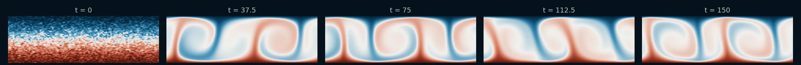
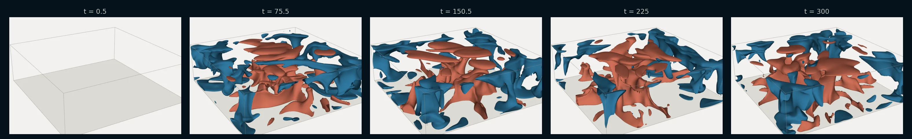

# Rayleigh–Bénard Convection (2D & 3D)

!!! source "Source"

    - **Script:** [`rayleigh_benard_sample.py`](https://github.com/tum-pbs/PICT/blob/main/rayleigh_benard_sample.py)
    - **Setup:** adapted from the code of [FluidGym](https://openreview.net/forum?id=ilEooI8fK1) (Becktepe et al., ICML 2026), where it is the uncontrolled flow of the Rayleigh–Bénard convection environments
    - **Run:** `python rayleigh_benard_sample.py` from the repository root (2D; the 3D runs are commented out at the end of the script)

A fluid layer is heated from below and cooled from above. Above a critical temperature difference, hot fluid rises and cold fluid sinks in convection cells. The temperature is a **passive scalar** with its own diffusivity, and a callback turns it into a buoyancy force. The coupling works like the [buoyant plume](buoyancy.md), but here the scalar has fixed values at the walls. The sample also computes the Nusselt number, the heat transport relative to pure conduction. The same setup runs [in 3D](#3d-a-square-layer), in a layer that is periodic in both horizontal directions.

=== "Temperature"

    <figure class="pict-media" markdown>
      <video autoplay loop muted playsinline poster="../../imgs/flows/rbc_temperature_poster.webp">
        <source src="../../assets/videos/rbc_temperature.mp4" type="video/mp4">
      </video>
      <figcaption>2D temperature at Ra = 8·10<sup>5</sup> from t = 0 to 150, between the cold upper wall (0, blue) and the hot lower wall (1, red). The domain is periodic in x. Output every 0.25 time units, finer than the sample's 1.0, with the setup and solver settings of the sample. Simulated with PICT and rendered for this website.</figcaption>
    </figure>

=== "Vorticity"

    <figure class="pict-media" markdown>
      <video autoplay loop muted playsinline poster="../../imgs/flows/rbc_vorticity_poster.webp">
        <source src="../../assets/videos/rbc_vorticity.mp4" type="video/mp4">
      </video>
      <figcaption>Vorticity of the same 2D run (blue: clockwise, red: counter-clockwise). Simulated with PICT and rendered for this website.</figcaption>
    </figure>

<figure markdown>
  
  <figcaption>Temperature at t = 0, 37.5, 75, 112.5 and 150: from the noisy conduction profile to plumes that rise from the hot wall and sink from the cold wall.</figcaption>
</figure>

**Setup** (default run of the sample)

- Layer of height 1 and length π (aspect ratio π), periodic in x, hot lower wall (T = 1) and cold upper wall (T = 0)
- One block of 96 × 61 cells, refined towards both walls
- Rayleigh number Ra = 8·10<sup>5</sup>, Prandtl number Pr = 0.7
- Initial state: linear conduction profile and fluid at rest, both with random perturbations (seed 0)
- 300 iterations of 1.0 time units, adaptive sub-steps with a CFL number of 0.5. According to the script, FluidGym uses 0.5 for Ra > 10<sup>5</sup>.

## Free-fall units

The sample measures lengths in layer heights and velocities in the free-fall velocity. With this scaling the viscosity and the thermal diffusivity follow from Ra and Pr alone, and the buoyancy force is simply the temperature:

```python title="rayleigh_benard_sample.py" linenums="123" hl_lines="4 5"
    # free-fall units: the layer height and the free-fall velocity are 1
    height = 1.0
    length = aspect_ratio*height
    viscosity = np.sqrt(Pr/Ra)
    diffusivity = 1/np.sqrt(Ra*Pr)
    res_y = round(2*res_x/aspect_ratio)
```

## Temperature as a passive scalar

The domain has one passive scalar channel. `setScalarViscosity` gives it a diffusivity that differs from the viscosity of the flow. The initial temperature falls linearly from the hot to the cold wall, with noise added and then clamped to the wall temperatures. The walls are closed, which replaces the default periodic boundaries in y, and they get fixed scalar values:

```python title="rayleigh_benard_sample.py" linenums="62" hl_lines="4 11 12 13 14 20 21 22 23"
    viscosity = torch.ones([1], dtype=dtype, device=cpu_device)*viscosity
    domain = PISOtorch.Domain(dims, viscosity, passiveScalarChannels=1, name="DomainRayleighBenard", device=cuda_device, dtype=dtype)
    # the passive scalar (temperature) has its own diffusivity, which is set as a global scalar viscosity
    domain.setScalarViscosity(torch.ones([1], dtype=dtype, device=cuda_device)*diffusivity)

    # initial state: linear temperature profile (pure conduction) and fluid at rest, both with random perturbations
    generator = torch.Generator()
    if seed is not None:
        generator.manual_seed(seed)
    y = shapes.coords_to_center_coords(grid)[:,1:2] # N1[D]HW
    temperature = T_hot + (T_cold - T_hot)*(y/height + 0.5)
    temperature = temperature + T_noise*(T_hot - T_cold)*torch.randn(temperature.shape, generator=generator, dtype=dtype)
    temperature = torch.clamp(temperature, min(T_hot, T_cold), max(T_hot, T_cold))
    velocity = vel_noise*torch.randn([1, dims] + list(temperature.shape[2:]), generator=generator, dtype=dtype)

    block = domain.CreateBlock(velocity=velocity.to(cuda_device).contiguous(), passiveScalar=temperature.to(cuda_device).contiguous(),
        vertexCoordinates=grid.to(cuda_device).contiguous(), name="BlockRayleighBenard")

    # boundaries are periodic by default, close the walls and set their temperature
    block.CloseBoundary("-y")
    block.CloseBoundary("+y")
    block.getBoundary("-y").setPassiveScalar(torch.tensor([[T_hot]], dtype=dtype, device=cuda_device))
    block.getBoundary("+y").setPassiveScalar(torch.tensor([[T_cold]], dtype=dtype, device=cuda_device))
```

## Buoyancy through a callback

Before the momentum system of every step is set up, the `PRE_VELOCITY_SETUP` callback sets the current temperature as the upward velocity source, with zeros for the other components (see [Callbacks](../guide/simulation.md#callbacks) and [Buoyancy](../guide/physics.md#buoyancy-coupling-a-scalar-back-into-the-flow)):

```python title="rayleigh_benard_sample.py" linenums="86" hl_lines="5 10"
    # buoyancy: the temperature is used as upward force, set as velocity source before the velocity of every step is computed
    vel_src_pad = torch.zeros_like(block.passiveScalar)
    def buoyancy_fn(domain, **kwargs):
        block = domain.getBlock(0)
        block.setVelocitySource(torch.cat([vel_src_pad, block.passiveScalar] + [vel_src_pad]*(dims-2), dim=1))
        domain.UpdateDomainData()

    domain.PrepareSolve()

    return domain, {"PRE_VELOCITY_SETUP": buoyancy_fn}, grid
```

## Nusselt number

The Nusselt number is computed from the volume average of the vertical velocity times the temperature. The cell volumes come from the block's transformation metrics, because the cells are not uniform. The sample logs it after every iteration through the `log_fn` of the simulation:

```python title="rayleigh_benard_sample.py" linenums="97" hl_lines="3 7"
def make_nusselt_fn(domain, Ra:float, Pr:float):
    # Nusselt number, the heat transport relative to pure conduction: Nu = 1 + sqrt(Ra*Pr)*<u_y*T>, with the volume average <.>
    cell_volume = domain.getBlock(0).transform[0,...,-1] # determinant of the cell transformations, [D]HW
    def nusselt_fn(domain):
        block = domain.getBlock(0)
        vel_y_T = block.velocity[0,1]*block.passiveScalar[0,0]
        return (1 + np.sqrt(Ra*Pr)*torch.sum(vel_y_T*cell_volume)/torch.sum(cell_volume)).item()
    return nusselt_fn
```

```python title="rayleigh_benard_sample.py" linenums="146" hl_lines="1 2 3"
    nusselt_fn = make_nusselt_fn(domain, Ra, Pr)
    def log_fn(domain, it, **kwargs):
        LOG.info("Nusselt number at t=%.02f: %.04f", it*time_step, nusselt_fn(domain))
```

According to the script, the plumes oscillate periodically at Ra = 8·10<sup>5</sup>, with the Nusselt number between ca. 4 and 12. In the run for the video, Nu oscillated between 3.5 and 12.9 from t = 100 to 150, with a period of about 5 time units.

## Running the simulation

The comment above the `Simulation` explains why 3D runs need a tighter pressure tolerance than the 2D run:

```python title="rayleigh_benard_sample.py" linenums="150" hl_lines="5 8 14"
    # The pressure tolerance is an absolute bound for the RMS of the flux residual per cell, and the fluxes of the smaller 3D cells are smaller.
    # In 3D 1e-5 is not enough: the projection then leaves a net vertical flow driven by the buoyancy, which stratifies the bulk and
    # about doubles the Nusselt number.
    sim = PISOtorch_simulation.Simulation(domain=domain, prep_fn=prep_fn,
            substeps="ADAPTIVE", adaptive_CFL=adaptive_CFL, time_step=time_step, corrector_steps=2, pressure_tol=1e-5 if res_z==0 else 1e-7,
            advect_non_ortho_steps=1, pressure_non_ortho_steps=1, pressure_return_best_result=True,
            velocity_corrector="FD", non_orthogonal=False,
            log_interval=1, norm_vel=True, log_fn=log_fn,
            output_resampling_shape=resample_shape, output_resampling_fill_max_steps=resample_fill_steps,
            log_dir=log_dir, save_domain_name="domain",
            stop_fn=STOP_FN)

    # make the random initial velocity divergence-free
    sim.make_divergence_free()
```

The script contains commented runs at Ra = 8·10<sup>4</sup> and 4·10<sup>5</sup>, as in the easy and medium environments of FluidGym. According to the script, their convection becomes steady after ca. 50 and 200 time units.

## 3D: a square layer

With `res_z` > 0, `makeRayleighBenardSetup` extrudes the wall-refined grid from z = 0 to z = π, so the layer is square in x–z. Only the walls in y are closed, so the block is periodic in x and z. The random initial velocity takes the shape of the 3D temperature, and the buoyancy callback above adds a zero z-component:

```python title="rayleigh_benard_sample.py" linenums="55" hl_lines="1 5 6"
    dims = 3 if res_z>0 else 2

    grid = shapes.make_wall_refined_ortho_grid(res_x, res_y, corner_lower=(0, -height/2), corner_upper=(length, height/2),
        wall_refinement=["-y", "+y"], base=wall_refinement_base, dtype=dtype)
    if dims==3:
        grid = shapes.extrude_grid_z(grid, res_z, start_z=0, end_z=length)
```

The script contains two commented 3D runs. The first one has the Rayleigh number and resolution of the 2D run, with 96 × 61 × 96 = 562,176 cells. The second one uses the setup of the hard 3D RBC environment of FluidGym:

```python title="rayleigh_benard_sample.py" linenums="186"
    # 3D with the same Rayleigh number and resolution in a domain that is square in x-z (96x61x96 cells).
    # After ca. 50 time units the Nusselt number fluctuates between ca. 7 and 9 around a mean of 7.8.
    #rayleigh_benard_sample(run_dir, name="Ra8e5_r96_3D", res_x=96, res_z=96, Ra=8e5, Pr=0.7, adaptive_CFL=0.5, iterations=300, time_step=1.0, dp=False, STOP_FN=stop_handler)

    # 3D as in the hard 3D RBC environment of FluidGym, the convection becomes steady with a Nusselt number of ca. 2.6
    #rayleigh_benard_sample(run_dir, name="Ra1e4_r64_3D", res_x=64, res_z=64, Ra=1e4, Pr=0.7, adaptive_CFL=0.5, iterations=300, time_step=1.0, dp=False, STOP_FN=stop_handler)
```

In the run of the first setup for the videos, the Nusselt number stayed between 6.9 and 8.8 after t = 50, with a mean of 7.8.

=== "Plume surfaces"

    <figure class="pict-media" markdown>
      <video autoplay loop muted playsinline poster="../../imgs/flows/rbc3d_plumes_poster.webp">
        <source src="../../assets/videos/rbc3d_plumes.mp4" type="video/mp4">
      </video>
      <figcaption>The 3D run at Ra = 8·10<sup>5</sup> from t = 0 to 300. The surfaces show where the temperature differs by 0.15 from the mean temperature at the same height, colored by this difference (red: warmer, blue: colder). Output every 0.5 time units, finer than the sample's 1.0, shown at 25 frames per second. Simulated with PICT, rendered for this website with vedo.</figcaption>
    </figure>

=== "Temperature volume"

    <figure class="pict-media" markdown>
      <video autoplay loop muted playsinline poster="../../imgs/flows/rbc3d_volume_poster.webp">
        <source src="../../assets/videos/rbc3d_volume.mp4" type="video/mp4">
      </video>
      <figcaption>The difference from the mean temperature at each height as a ray-cast volume, divided by its root mean square at that height over the second half of the run (red: warmer, blue: colder). It is transparent below 1 and nearly opaque above 1.15 times the root mean square. Simulated with PICT, rendered for this website with vedo.</figcaption>
    </figure>

<figure markdown>
  
  <figcaption>Plume surfaces at t = 0.5, 75.5, 150.5, 225 and 300. At first no temperature difference reaches the surface value; later warm plumes rise from the hot wall and cold plumes sink from the cold wall.</figcaption>
</figure>

??? info "How the videos were made"

    **2D:** `scripts/sim_flow_examples.py rbc` builds the domain with `makeRayleighBenardSetup` of the sample (seed 0) and runs it with the solver settings of the sample, but with an output time step of 0.25 instead of 1.0 for a smooth video: 600 iterations, t = 0 to 150. A log callback records the vorticity, the temperature and the Nusselt number after every iteration. `scripts/render_flow_examples.py` wraps the cells around the periodic boundary for the interpolation to pixels, and encodes the videos and the strip.

    **3D:** `scripts/sim_3d_examples.py rbc` runs `rayleigh_benard_sample()` itself with the arguments of the first commented 3D run, but with an output time step of 0.5 instead of 1.0: 600 iterations, t = 0 to 300. A log callback records the temperature of all cells and the Nusselt number after every iteration. `scripts/render_3d_examples.py` interpolates the temperature linearly between the cell centers and the wall temperatures to uniform points in y, subtracts the mean at each height, and renders the surfaces and the volume with vedo. The 600 iterations took about 26 minutes on the RTX 3060 used for this website, including the recording.
