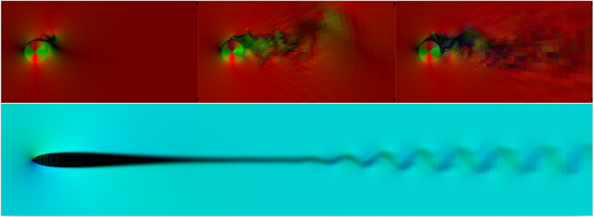

# Vortex Street

!!! source "Source"

    - **Scripts:** [`vortex_street_torus_sample.py`](https://github.com/tum-pbs/PICT/blob/main/vortex_street_torus_sample.py) (cylinder on a ring grid), [`vortex_street_sample.py`](https://github.com/tum-pbs/PICT/blob/main/vortex_street_sample.py) and [`vortex_street_refined_sample.py`](https://github.com/tum-pbs/PICT/blob/main/vortex_street_refined_sample.py) (square obstacle in a channel)
    - **Run:** `python vortex_street_torus_sample.py` from the repository root

Flow past a bluff body is the textbook example of unsteady separated flow. Beyond the physics, these samples show the multi-block features of PICT: curvilinear blocks, block connections, inflow and advective outflow boundaries, and moving walls.

<figure class="pict-media" markdown>
  <video autoplay loop muted playsinline poster="../../imgs/vortex_street_poster.webp">
    <source src="../../assets/videos/vortex_street.mp4" type="video/mp4">
  </video>
  <figcaption>Kármán vortex street behind a cylinder at Re = 200, simulated with PICT on the 4-block ring grid of <code>vortex_street_torus_sample.py</code> (non-rotating cylinder, 48 cells per quadrant). Color shows vorticity (blue: clockwise, red: counter-clockwise). Rendered for this website.</figcaption>
</figure>

## The ring grid around a cylinder

`vortex_street_torus_sample.py` builds a disk-shaped domain around the cylinder from four quarter-ring blocks. In each block, x runs along the angle and y runs radially. The y-resolution is chosen such that cells are approximately square, so they grow with the radius.

```python
def make4BlockTorus_VortexStreet(x, r1=0.5, r2=8,
        z:int=0, z_size=1, z_closed=False,
        rot_vel=0, obs_vel_z=0, vel_in=1,
        scaling=None, rotation_distortion_max_angle=None, z_sine_scale=None,
        viscosity=1e-3, dtype=torch.float32):
    dims = 3 if z > 0 else 2
    domain = PISOtorch.Domain(dims, torch.tensor([viscosity], dtype=dtype, device=cpu_device), name="DomainTorusParts",
                              dtype=dtype, device=cuda_device, passiveScalarChannels=0)

    # four quarter rings, x along the angle, y from the inner radius r1 to the outer radius r2
    torus_coords = [shapes.make_torus_2D(x, r1=r1, r2=r2, start_angle=a, angle=-90, dtype=dtype)
                    for a in (90, 0, -90, -180)]
    if dims == 3:                                    # extrude the rings in z
        torus_coords = [shapes.extrude_grid_z(grid, z, end_z=z_size, weights_z=None, exp_base=1.05)
                        for grid in torus_coords]
    for t_idx, coords in enumerate(torus_coords):
        block = domain.CreateBlock(vertexCoordinates=coords.to(cuda_device).contiguous(), name="Torus%d" % t_idx)
        block.CloseAllBoundaries()
    torus_blocks = domain.getBlocks()
    torus_tr, torus_br, torus_bl, torus_tl = torus_blocks

    # close the ring: +x of each quarter connects to -x of the next one
    axes = ["-y", "-z"] if dims == 3 else ["-y"]
    for i in range(4):
        torus_blocks[i].ConnectBlock("+x", torus_blocks[(i + 1) % 4], "-x", *axes)
    ...
```

(Abridged: the full function can additionally scale the grid and distort it, by a rotation around the center or a z-sine displacement, to test the solver on worse meshes.)

The inner boundary of the ring (`-y`) is the cylinder wall. The outer boundary (`+y`) is the inflow on the left half and the outflow on the right half:

```python
    for block in torus_blocks:                       # initialize with the free-stream velocity
        block.velocity[:, 0, ...] = vel_in

    vel_in = torch.tensor([[vel_in] + [0] * (dims - 1)], dtype=dtype, device=cuda_device)
    torus_tl.getBoundary("+y").setVelocity(vel_in)   # inflow on the left
    torus_bl.getBoundary("+y").setVelocity(vel_in)

    out_bounds = [torus_tr.getBoundary("+y"), torus_br.getBoundary("+y")]   # outflow on the right
    for out_bound in out_bounds:
        out_bound.setVelocity(vel_in)
        out_bound.makeVelocityVarying()
    PISOtorch_simulation.balance_boundary_fluxes(domain, out_bounds)

    # advect the outflow values before every step
    prep_fn = lambda domain, time_step, **kwargs: PISOtorch_simulation.update_advective_boundaries(
        domain, out_bounds, vel_in, time_step.cuda())
    domain.PrepareSolve()
    return domain, {"PRE": prep_fn}, ...
```

A **rotating cylinder** is set up by giving the inner boundary a tangential velocity per boundary cell. The sample's default run is a cylinder at Re = 1000 that rotates with a surface speed of 2:

```python
if rot_vel != 0:
    # tangential velocity for every boundary cell around the circumference
    bound_vel = ...   # shape [1, dims, 1, 4*x], split into one part per block
    for block, bound_vel_part in zip(torus_blocks, torch.split(bound_vel, x, dim=-1)):
        block.getBoundary("-y").setVelocity(bound_vel_part.contiguous())
```

The simulation projects the initial field onto a divergence-free field first and then runs with adaptive time steps:

```python
sim = PISOtorch_simulation.Simulation(domain=domain, prep_fn=prep_fn, output_resampling_shape=resample_shape,
        substeps="ADAPTIVE", time_step=0.25, corrector_steps=2, advection_tol=1e-6, pressure_tol=1e-6,
        advect_non_ortho_steps=2, pressure_non_ortho_steps=4, pressure_return_best_result=True,
        velocity_corrector="FD", non_orthogonal=True, log_interval=1, log_dir=log_dir)
sim.preconditionBiCG = False
sim.BiCG_precondition_fallback = True
sim.make_divergence_free()
sim.run(200)
```

With `z > 0`, the rings are extruded to 3D, periodic in z by default or closed with `z_closed=True`. The cylinder can then also slide along its axis (`obs_vel_z`).

<figure markdown>
  { .on-white }
  <figcaption>Top: center slice of the velocity of a 3D flow around a rotating cylinder at frames 8, 30 and 200, with the velocity mapped to RGB. Bottom: developed 2D flow around and behind a NACA 0012 airfoil, with the 2D velocity mapped to a color circle (see <a href="../airfoil/">NACA 0012 Airfoil</a>). Each cell is drawn with a constant color to show the varying cell sizes. (Franz et al. 2026, Fig. B.18; also in the PICT repository)</figcaption>
</figure>

## Square obstacle in a channel

`vortex_street_sample.py` builds a channel around a square obstacle from **eight blocks**. They are arranged as a ring, and the missing center block becomes the obstacle:

```text
   Btl | Btm | Btr        t = top, m = middle, b = bottom
   ----+-----+----        l = left, r = right
   Bml | obs | Bmr        the obstacle faces of Btm, Bml, Bmr, Bbm are closed (walls)
   ----+-----+----
   Bbl | Bbm | Bbr
```

The top and bottom faces are either connected to each other, making the channel periodic in y, or closed as walls. The inflow on the left can be uniform or Gaussian, and a passive scalar enters through the inflow section in line with the obstacle. The obstacle walls use Neumann conditions for the scalar. `vortex_street_refined_sample.py` builds the same topology from graded grids that are refined towards the obstacle (see [Grids](../guide/grids.md)). The learned vortex-street corrector of the paper also uses a square obstacle in a channel; its exact geometry and grid are given in the paper's appendix, see also [Results](../background/results.md#2d-vortex-street-learned-corrector-with-unrolled-training).

## Running

```bash
python vortex_street_torus_sample.py      # 2D rotating cylinder, 200 iterations; 3D variant commented in the script
python vortex_street_sample.py
python vortex_street_refined_sample.py
```
