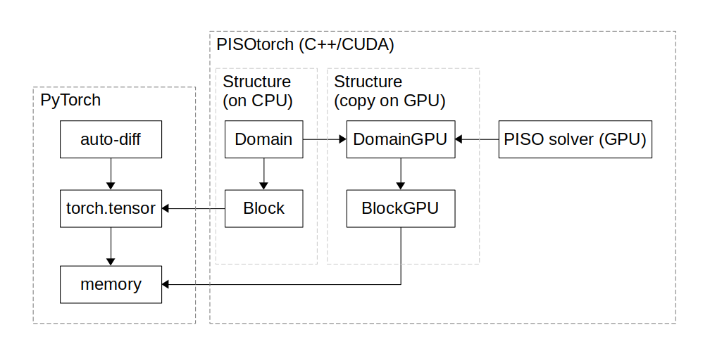

# Core Concepts

This page introduces the objects a PICT simulation is built from and how they relate to PyTorch. The later pages of the user guide go into the details of each part.

## Domain, Block and Boundary

A complete simulation setup lives in a **`Domain`**. The domain holds global settings and a list of blocks (**`Block`**):

- **`PISOtorch.Domain`** holds:
    - the number of spatial dimensions (1–3),
    - the viscosity,
    - the data type (`torch.float32` or `torch.float64`) and the CUDA device,
    - the number of passive scalar channels,
    - the global solver data: the advection–diffusion matrix `C`, its diagonal `A`, the pressure matrix `P`, and the right-hand-side and result vectors of all linear systems.
- **`PISOtorch.Block`** is a structured grid, regular or curvilinear. It holds:
    - the fields: `velocity`, `pressure` and `passiveScalar`,
    - an optional `velocitySource` (a forcing term) and an optional per-block or per-cell `viscosity`,
    - its vertex coordinates and the transformation metrics derived from them,
    - one **boundary** per face (2 × dims of them).
- **Boundaries** describe what happens at each block face:
    - `PeriodicBoundary` wraps around to the opposite face of the same block.
    - `ConnectedBoundary` joins the face to a face of another block.
    - `FixedBoundary` prescribes values: Dirichlet velocity, and Dirichlet or Neumann passive scalars.

<figure markdown>
  { .on-white width="640" }
  <figcaption>The <code>Domain</code>/<code>Block</code> structure lives on the CPU and references <code>torch.tensor</code>s. For a solve, it is packed into GPU-side copies (<code>DomainGPU</code>, <code>BlockGPU</code>) that hold raw pointers into the same tensor memory.</figcaption>
</figure>

All field data is stored in ordinary **PyTorch tensors on the GPU**. The domain with its blocks only provides the *structural* information and holds references to the tensors. For simulation, the structure is packed and copied to the GPU as internal `DomainGPU` and `BlockGPU` structures. These contain raw memory pointers to the memory underlying the tensors. Each simulation step overwrites this memory with its result, unless the differentiable mode is used.

This design has an important consequence: **PyTorch knows nothing about the domain–block setup or the simulation, and the GPU solver knows nothing about PyTorch's autograd.** The [`PISOtorch_diff`](differentiable.md) wrapper bridges the two. In each step it replaces the tensors held by the domain and its blocks with new ones, which keeps the autograd graph intact.

## Tensor layout

Fields use the PyTorch "channels first" layout, **NCDHW** in 3D, NCHW in 2D and NCW in 1D:

- **N**, the batch dimension, must always be **1**.
- **C** holds channels, such as the components of a vector or several passive scalars.
- **Spatial dimensions are in `zyx` order** (D = depth/z, H = height/y, W = width/x).
- **Vector components in the channel dimension are in `xyz` order.**

| Quantity | 2D shape | 3D shape | Notes |
|---|---|---|---|
| `block.velocity` | `[1, 2, y, x]` | `[1, 3, z, y, x]` | components `(u, v[, w])` |
| `block.pressure` | `[1, 1, y, x]` | `[1, 1, z, y, x]` | |
| `block.passiveScalar` | `[1, S, y, x]` | `[1, S, z, y, x]` | `S = passiveScalarChannels` |
| `block.vertexCoordinates` | `[1, 2, y+1, x+1]` | `[1, 3, z+1, y+1, x+1]` | cell corners, coordinates in `xyz` order |
| `block.velocitySource` | `[1, 2]` or `[1, 2, y, x]` | `[1, 3]` or `[1, 3, z, y, x]` | static (one value) or per cell |
| `block.viscosity` | `[1, 1]` or `[1, 1, y, x]` | `[1, 1]` or `[1, 1, z, y, x]` | optional, replaces the domain viscosity on this block |
| `domain.viscosity` | `[1]` | `[1]` | **CPU** tensor |

Each block needs **at least 3 cells along every axis**. Tensors handed to PICT must be on the GPU and contiguous; call `.cuda().contiguous()` when in doubt.

## Life cycle of a setup

The following script simulates a plane Poiseuille flow, one of the validation cases of the paper: a channel of height 1 with no-slip walls, periodic in x, driven by a constant body force \(G = 1\). With \(\nu = 1\), the steady state is the parabola \(u(y) = \tfrac{G}{2\nu}\,y(1-y)\) with a maximum of 0.125.

```python
import torch
import PISOtorch, PISOtorch_simulation
import lib.data.shapes as shapes

dims, dtype = 2, torch.float32
viscosity = torch.tensor([1.0], dtype=dtype)        # CPU tensor, shape [1]

# 1. the domain: global settings
domain = PISOtorch.Domain(dims, viscosity, name="Channel",
                          device=torch.device("cuda"), dtype=dtype,
                          passiveScalarChannels=0)

# 2. a block from vertex coordinates: here the unit square with 16 x 16 cells
grid = shapes.make_wall_refined_ortho_grid(16, 16)   # shape [1, 2, 17, 17]
block = domain.CreateBlock(vertexCoordinates=grid.cuda().contiguous(), name="Block")

# 3. boundaries: all faces are periodic by default
block.CloseBoundary("-y")    # no-slip walls at -y and +y, x stays periodic

# a constant body force G = 1 in +x drives the flow through the periodic channel
block.setVelocitySource(torch.tensor([[1.0, 0.0]], device="cuda", dtype=dtype))

# 4. finalize: validates the setup and allocates matrices, RHS and result tensors
domain.PrepareSolve()

# 5. simulate (no output directory, so image output is switched off)
sim = PISOtorch_simulation.Simulation(domain=domain, time_step=0.1, non_orthogonal=False, log_images=False)
sim.run(iterations=50)

u = block.velocity[0, 0, :, 0]                       # u(y) at the cell centers
y = block.getCellCoordinates()[0, 1, :, 0]
print(float(torch.max(torch.abs(u - 0.5 * y * (1 - y)))))   # deviation from the analytic profile
```

After 50 steps of size 0.1, the flow has reached its steady state: the script prints a deviation of about \(5\cdot10^{-4}\) from the analytic profile, whose maximum is 0.125. Instead of vertex coordinates, a block can also be created from a resolution alone with `domain.CreateBlockWithSize(PISOtorch.Int4(x=16, y=16))`, which gives cells of unit size (see [Grids](grids.md)).

Two calls keep the CPU structure and the GPU copy consistent:

- **`domain.PrepareSolve()`** must be called once after the setup is complete, before a `Simulation` is created, and again after structural changes. It checks the setup for validity and creates the secondary tensors: matrices, right-hand sides, results and gradients.
- **`domain.UpdateDomainData()`** must be called whenever you *replace* a tensor, e.g. with `block.setVelocity(...)`, `block.setVelocitySource(...)` or `boundary.setVelocity(...)`. It refreshes the pointers in the packed GPU structure. Every [callback](simulation.md#callbacks) that sets tensors on the domain should end with it.

Modifying a tensor *in place* (e.g. `block.velocity[:, 0] = 1.0`) keeps its memory and needs no update. In the differentiable mode, however, prefer setting new tensors so that autograd can track the change.

## Copy, Clone and Detach

| Method | Structure | Tensors | Typical use |
|---|---|---|---|
| `domain.Copy()` | new `Domain`/`Block`/boundary objects | **shared** with the original | a per-iteration domain for training: a differentiable run creates new tensors, so the original stays untouched |
| `domain.Clone()` | new objects | **deep copies** | an independent reference/target simulation |
| `domain.Detach()` | — | detached from the autograd graph (forward and gradient tensors) | **after every optimization step**, to break reference cycles between the domain and the graph |

Call `PrepareSolve()` on a copy or clone before using it.

!!! warning "Shared tensors"
    A `Copy()` shares the underlying tensors with its original. Running a **non-differentiable** simulation on the copy overwrites them in place, so it changes both domains. A **differentiable** simulation writes new tensors and leaves the original unchanged.

## Saving and loading

```python
from lib.util.domain_io import save_domain, load_domain

save_domain(domain, "runs/state")          # writes runs/state.json (structure) + runs/state.npz (tensors)
domain = load_domain("runs/state", dtype=torch.float32, device=torch.device("cuda"))
domain.PrepareSolve()                      # load_domain does not allocate the solver tensors
```

`Simulation(save_domain_name="domain", log_dir=...)` saves the final state of a run in the same format.

## The simulation driver

Low-level operators such as `PISOtorch.SetupAdvectionMatrix`, `PISOtorch.SolveLinear` and `PISOtorch.CorrectVelocity` are exposed individually (see the [API reference](../api/pisotorch.md)). Usually you do not call them yourself. **`PISOtorch_simulation.Simulation`** combines them into full PISO time steps and provides:

- fixed or CFL-adaptive time stepping,
- callbacks at many points of the step,
- logging, image and VTK output,
- a single switch, `differentiable=True`, that routes every operator through the autograd-enabled `PISOtorch_diff` backend.

See [Running Simulations](simulation.md).
