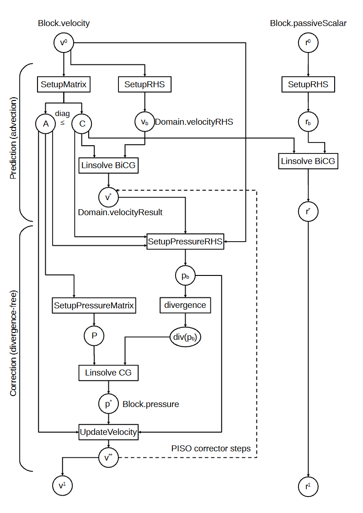

# Differentiable Simulation

Every simulation step in PICT can be differentiated. With

```python
sim = PISOtorch_simulation.Simulation(domain=domain, ..., differentiable=True)
```

all PISO operators are routed through **`PISOtorch_diff`**. There, each CUDA operator is wrapped in a `torch.autograd.Function` whose backward pass calls a hand-written CUDA gradient kernel. You can then compute any loss from the simulated fields and call `loss.backward()`. The gradients flow through all unrolled solver steps into whatever influenced them: initial conditions, forcings, viscosities, boundary values, or the parameters of a neural network that produced them.

## What you can differentiate

| Quantity | Differentiable | Notes |
|---|---|---|
| velocity, passive scalars (initial and intermediate states) | yes | scalars with `non_orthogonal=False`: the non-orthogonal scalar path uses `CopyScalarResultFromBlocks`, whose backward pass is not implemented |
| velocity sources `block.velocitySource` | yes | static or per cell, e.g. the output of a network |
| viscosity (global, per block, per cell) and scalar diffusivity | yes | |
| fixed-boundary velocities and scalar values | yes | e.g. a lid velocity or an inflow profile |
| grid coordinates and transformation metrics | **no** | no shape optimization through the mesh |
| time step size | no | |
| velocity correctors `"FVM_CENTER"`, `"FVM_FACE"` | no | use the default `velocity_corrector="FD"` |
| Smagorinsky helper, resampling, eigen decomposition | no | forward-only utilities (`PISOtorch_diff.matmul` is differentiable) |

## How the gradients are computed

<figure markdown>
  { .on-white width="460" }
  <figcaption>Computational graph of one PISO step. Prediction: the advection matrix and right-hand side are set up from the velocity, followed by a BiCGStab linear solve. Correction: the pressure system is set up and solved with CG, then the velocity is updated; this repeats for every corrector step. Passive scalars (right) are advected with the same matrix. Every box is a differentiable operator.</figcaption>
</figure>

PICT follows a **discretize-then-optimize** approach. Backpropagation runs through the discrete PISO graph above, and every operator has an analytically derived backward kernel. The **linear solves** are the exception: they are treated with the adjoint method instead of being unrolled through the solver's iterations. For a solve \(A\mathbf{x} = \mathbf{b}\) and an incoming gradient \(\partial L/\partial\mathbf{x}\):

\[
A^{\mathsf T}\boldsymbol{\lambda} = \frac{\partial L}{\partial \mathbf{x}}, \qquad
\frac{\partial L}{\partial \mathbf{b}} = \boldsymbol{\lambda}, \qquad
\frac{\partial L}{\partial A} = -\boldsymbol{\lambda}\,\mathbf{x}^{\mathsf T}\Big|_{\text{sparsity pattern of }A}.
\]

The adjoint system is solved with the forward solver code (CG or BiCGStab), with an option to transpose the matrix. The matrix gradient is only evaluated on the non-zero entries of the sparse matrix (a sampled outer product).

In differentiable mode, the operators write **new tensors** instead of overwriting the old ones, so the history of all unrolled steps is kept for the backward pass. Memory therefore grows with the number of differentiable steps.

All differentiable workflows in the repository (`learning_sample.py`, `channel_flow_learning.py`) use `non_orthogonal=False`. The simulation code labels this branch as the one "with gradient/backprop support".

## A minimal optimization

This condensed version of `learning_sample.py` recovers an unknown constant forcing from a target simulation. The target is created by simulating a clone of the domain with the forcing \((1, 0)\). The optimization then starts from zero and backpropagates through 3 solver steps per iteration:

```python
forcing = torch.zeros([1, 2], device=cuda_device, dtype=dtype, requires_grad=True)
optimizer = torch.optim.SGD([forcing], lr=1e-2)

for opt_step in range(20):
    opt_domain = domain.Copy()                             # new structure, tensors shared with `domain`
    opt_domain.getBlock(0).setVelocitySource(forcing)
    opt_domain.PrepareSolve()

    sim = PISOtorch_simulation.Simulation(opt_domain, substeps=1, time_step=0.1,
                                          non_orthogonal=False, differentiable=True,
                                          log_images=False)                # no output directory
    sim.run(3, log_domain=False)                           # differentiable: writes new tensors

    loss = sum(torch.sum((b.velocity - t.velocity) ** 2)
               for b, t in zip(opt_domain.getBlocks(), target_domain.getBlocks()))
    loss.backward()                                        # through all 3 PISO steps
    optimizer.step()
    optimizer.zero_grad()
    opt_domain.Detach()                                    # break reference cycles, see below
```

<figure markdown>
  
  
  <figcaption>Output of the optimization above, computed with the current PICT code (<code>scripts/sim_learning.py</code>). The loss drops from 21.5 to 2.7 × 10⁻⁸ in 20 gradient-descent steps, and the forcing converges to the true value \(f_x = 1\).</figcaption>
</figure>

??? note "Data table (the forcing column holds the value used in that step)"
    | step | loss | \(f_x\) |
    |---:|---:|---:|
    | 0 | 2.15e+01 | 0.00000 |
    | 1 | 6.99e+00 | 0.42955 |
    | 2 | 2.27e+00 | 0.67458 |
    | 5 | 7.84e-02 | 0.93959 |
    | 10 | 2.86e-04 | 0.99635 |
    | 15 | 1.04e-06 | 0.99978 |
    | 19 | 2.71e-08 | 0.99996 |

## Gradient paths: trading accuracy for speed

The linear solves take most of the runtime, typically 70–90%, and their adjoint solves dominate the backward pass. The gradient through one PISO step splits into three additive groups of paths:

\[
\frac{\partial \mathbf{u}^{n}}{\partial \mathbf{u}^{n-1}} = J^{\text{Adv}} + J^{P} + J^{\text{none}},
\]

through the advection solve, through the pressure solve, and through neither (via the matrix and right-hand-side setup). The first two can be dropped individually:

```python
sim = PISOtorch_simulation.Simulation(..., differentiable=True,
                                      exclude_advection_solve_gradients=True,   # drop J^Adv
                                      exclude_pressure_solve_gradients=True)    # drop J^P
```

The excluded solves then run under `torch.no_grad()`. The paper's ablation found:

- **Short rollouts:** for short unrolls, the approximate gradients converge just as well and up to 2× faster in wall-clock time.
- **Longer unrolls:** here the advection path becomes important. Without any solve gradients, the 100-step optimization diverged, while dropping only the pressure path remained the fastest variant.

A practical recipe from the paper is to train with approximate gradients first and to re-enable the solve gradients for fine-tuning. See [Results from the Paper](../background/results.md#gradient-paths).

For finer control, `PISOtorch_diff.exclude_gradient(function_name, grad_name, is_gradient_input)` zeroes individual gradient tensors of an operator, and `PISOtorch_diff.clear_excluded_gradients()` resets this.

## Memory and performance tips

- **Call `domain.Detach()` after every optimization step.** The domain and the autograd graph reference each other. Without detaching, these reference cycles leak GPU memory until training crashes.
- **Use a fresh `domain.Copy()` per optimization step.** A differentiable run creates new tensors, so the base domain is not modified and can be reused.
- **Warm up without gradients.** To start from a developed flow, first run some steps with `differentiable=False` (cheap, in-place) and only unroll the last steps differentiably. The channel-flow training uses this, randomizing the number of non-differentiable "pre-steps".
- **Keep unrolls short at first.** Memory and backward cost grow with the number of differentiable steps. Curricula of increasing unroll length are common.
- **Check gradients in double precision.** `tests/gradcheck.py` runs `torch.autograd.gradcheck` on the PISO operators in `float64`. Use `dtype=torch.float64` for such checks.
